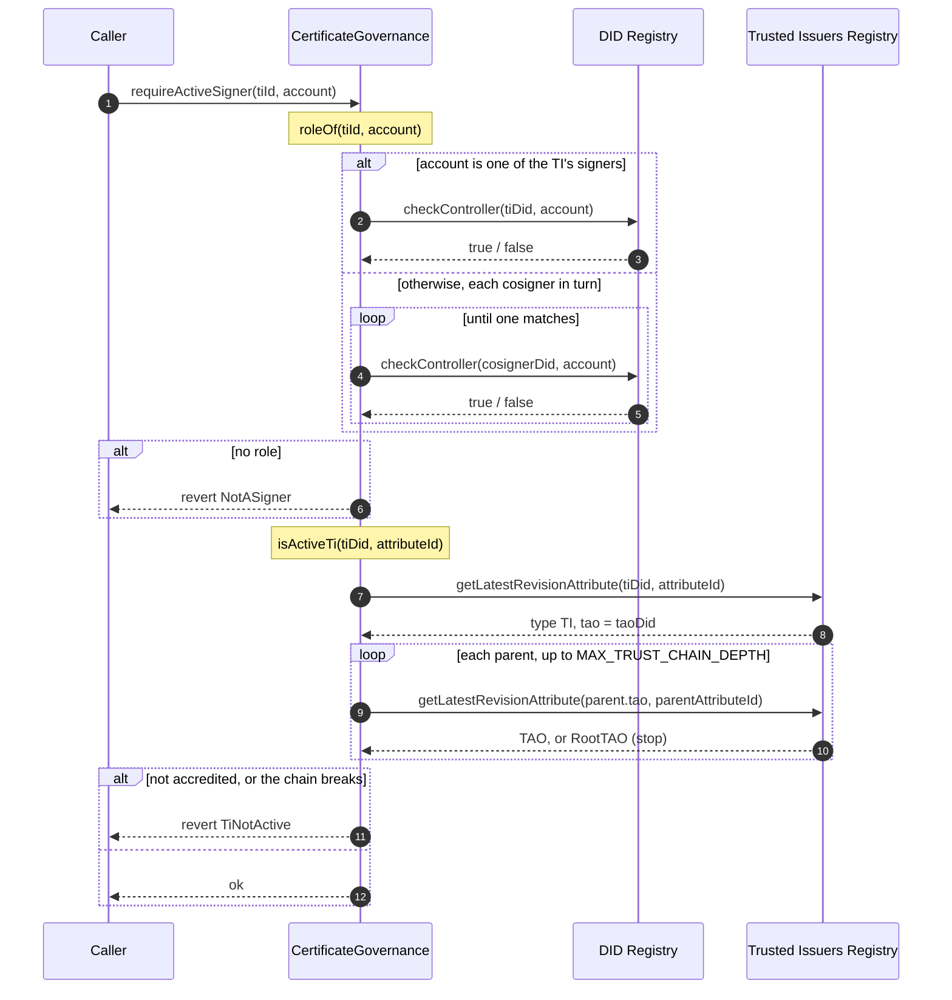
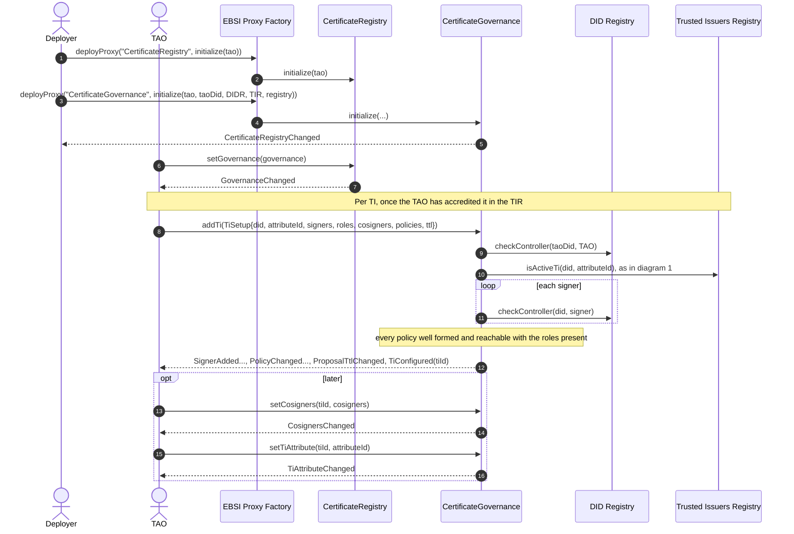
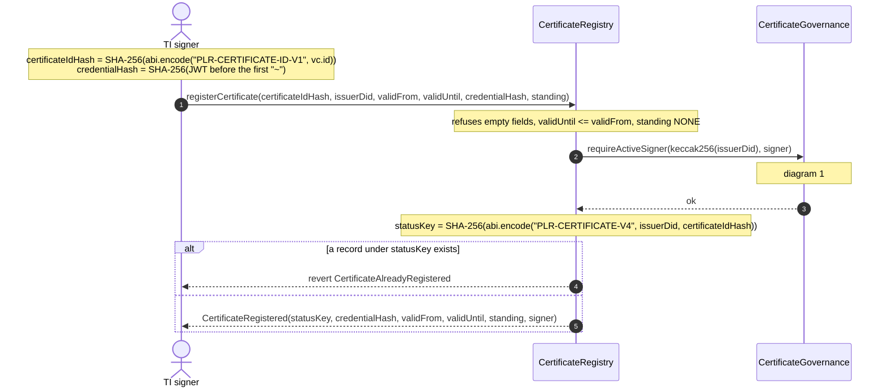
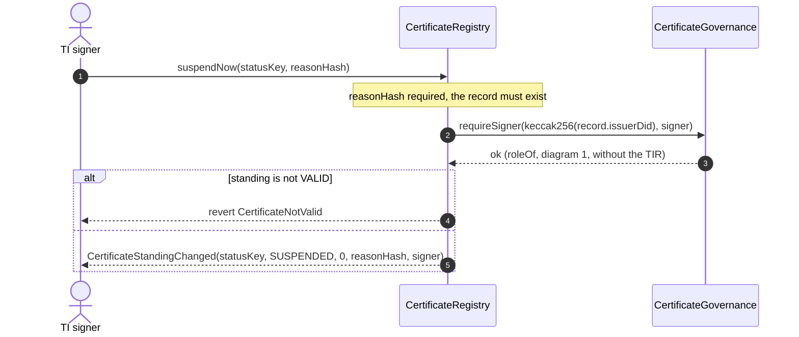
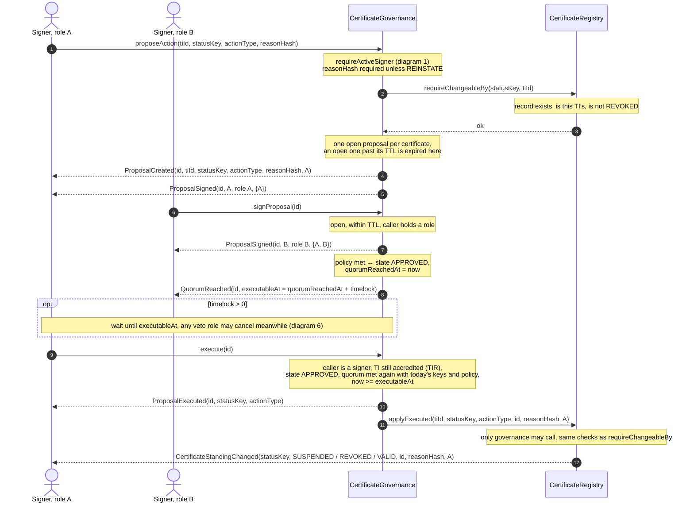
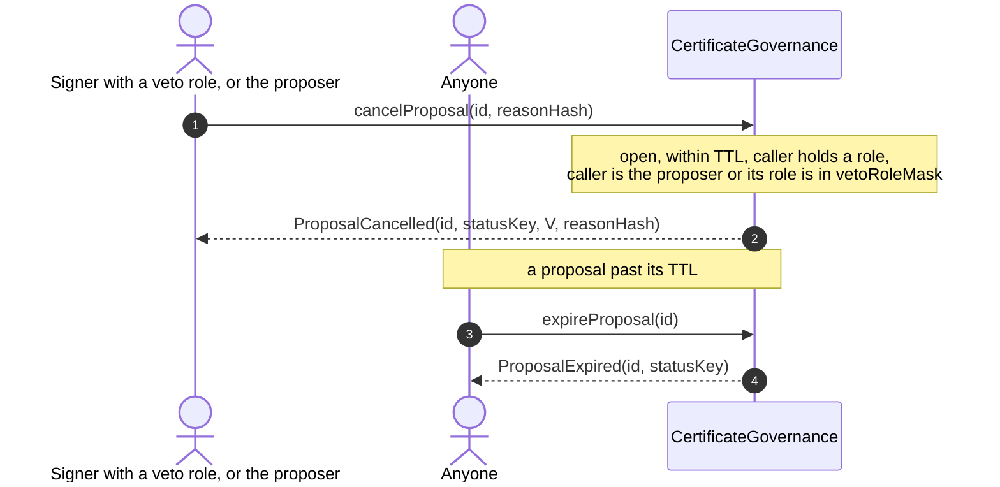
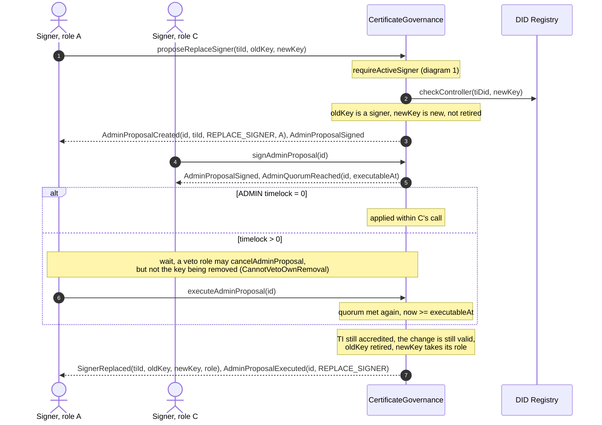
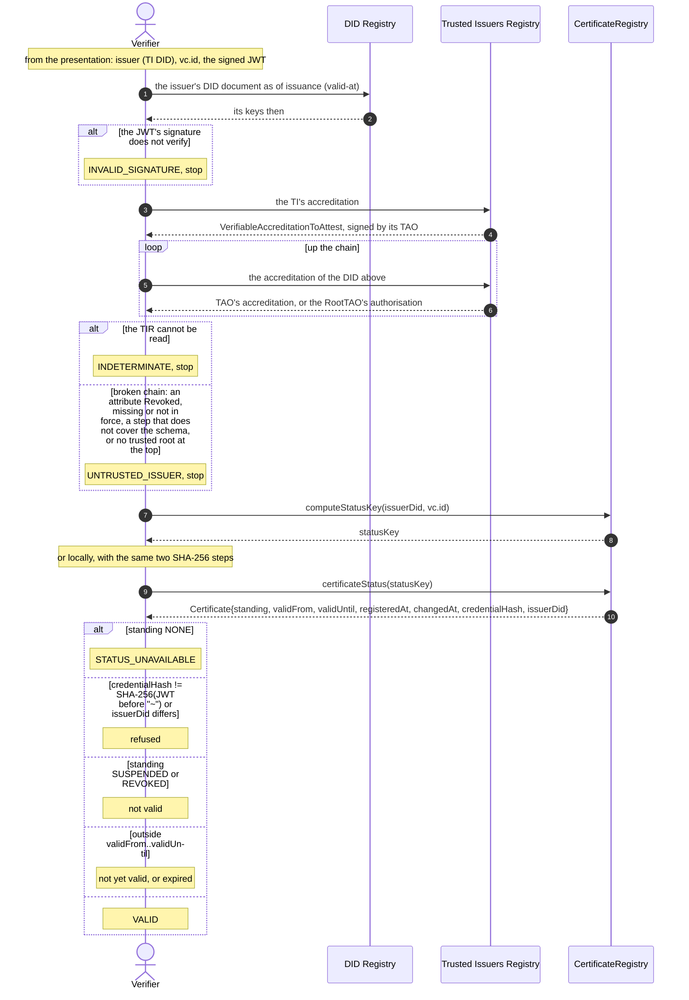
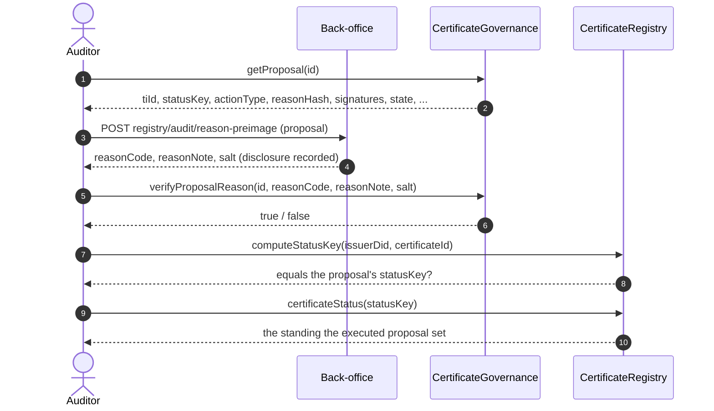

# Sequence diagrams

How the two contracts work with each other and with EBSI's registries. The
first diagram is the check that most other calls start with. The contracts
themselves are described in [README.md](../README.md).

Participants:

| Name | What it is |
|---|---|
| `CertificateRegistry` | The records and their standing. All a verifier reads. |
| `CertificateGovernance` | TIs, signers, cosigners, policies and proposals, one contract per TAO. |
| DID Registry | EBSI's DIDR: which keys are valid keys of a DID. |
| Trusted Issuers Registry | EBSI's TIR: who accredited whom. |
| TAO | The contract's owner; acts with a key of its DID. |
| TI signer | A key of the TI's DID, or of a cosigner's DID, with a role. |

## 1. Is this key a signer of this TI, and is the TI accredited?

The check has two parts:

1. **The key signs for this TI.** It is one of the TI's signer keys and the
   DID Registry still shows it as a valid key of the TI's DID, or it is a valid
   key of one of the TI's cosigner DIDs. Either way it holds a role (A, B, C,
   ...), which quorums and veto rights count. A key the DID Registry no longer
   shows has no role.
2. **The TI is accredited.** The Trusted Issuers Registry shows the TI's
   accreditation by the TAO, and every step above it up to the RootTAO.

`requireActiveSigner(tiId, account)` checks both, when something starts:
registering a certificate, proposing a status change or a rule change.
`requireSigner(tiId, account)` checks only the first part. It is used for
every signature, for a veto and for `suspendNow`.

## 2. Deployment and setting up a TI

Both contracts run behind a beacon proxy. The registry is deployed
first, governance is initialized with its address, and then the registry is
pointed at governance.

## 3. Registering a certificate

The record is written once the holder has collected the certificate, when the
credential's id and its signed JWT exist: the record's key is computed from the
TI's DID and that id, and the record keeps the JWT's hash.

## 4. Emergency suspension

One signature, no quorum (component 10.6). It does not ask whether the TI is
still accredited: a revoked TI's certificates are withdrawn this way.

## 5. A status proposal: suspend, revoke or reinstate

The proposer's call counts as the first signature. Quorum counts distinct roles
under the action's policy. A revocation usually has a timelock; a suspension
and a reinstatement usually do not; either way the proposal is `APPROVED`
until it is executed.

If a signer key is removed or replaced after the quorum and a later signature
brings the quorum back, `quorumReachedAt` restarts and `QuorumReached` is
emitted again.

## 6. Veto, withdrawal and expiry

## 7. A rule change of a TI

Signers, policies and the proposal TTL change only through the TI's ADMIN
policy (component 10.4). Without a timelock, the signature that completes the
quorum applies the change.

## 8. A verifier checks a certificate

A verifier reads EBSI's registries and the certificate registry, and needs
neither the back-office nor the TI. The contract does not judge the trust
chain when it is read: the verifier checks the chain itself, in the Trusted
Issuers Registry, before it reads the record. A broken chain stops it there,
whatever the record says.

## 9. An auditor checks a proposal

The reason is on chain only as a salted commitment. Its pre-image comes
from the back-office, which records each disclosure.

