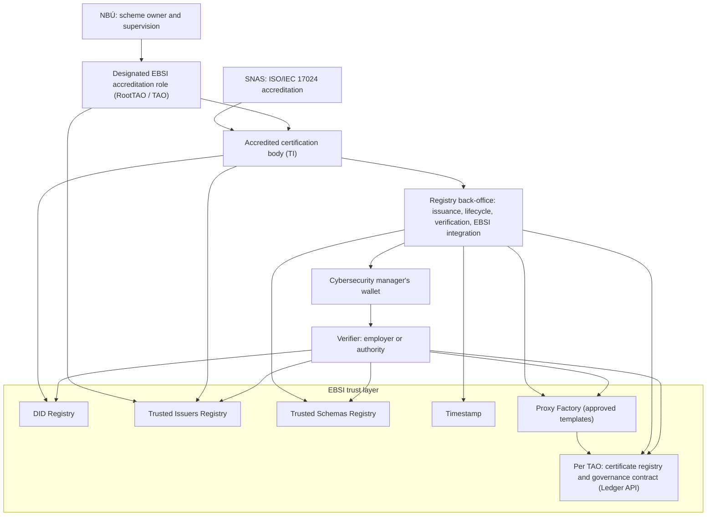
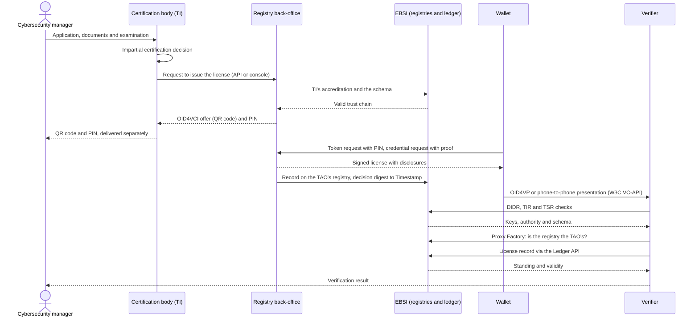
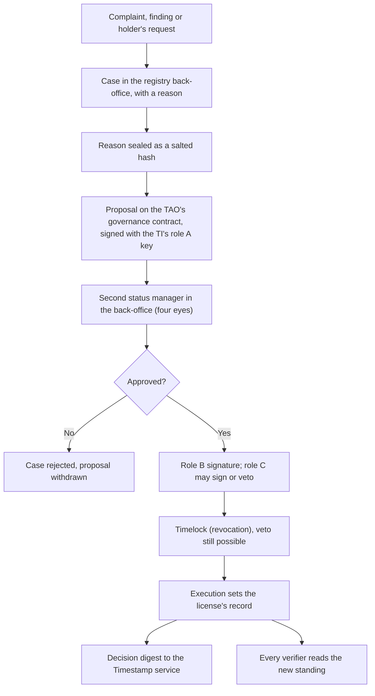

# Architectural Design
# Professional License Registry on EBSI

**Project:** Professional License Registry
**Domain:** Cybersecurity / licenses of persons
**Technology platform:** European Blockchain Services Infrastructure (EBSI)
**Document version:** 5.0
**Date:** November 2026
**Design status:** Prototype architecture
**Intended for:** Project sponsor / management / implementation team

---

## Management summary

This document describes the architecture of a system for issuing, holding, presenting and verifying the licenses of cybersecurity professionals. A license is the digital record of a natural person's professional competence. An accredited certification body attests it under the applicable scheme. It is not a permit that NBÚ or SK-CERT issues automatically.

The system uses EBSI as the European trust layer. The EBSI registries establish three things: the identity and authority of the certification body, its accreditation chain, and the schema of the license it issues. The license itself is issued as a W3C Verifiable Credential and kept in the cybersecurity manager's digital wallet.

The standing of each license is recorded on a certificate registry contract on the EBSI ledger: valid, suspended or revoked. A governance contract next to it decides every change.
- **Single source of truth.** The record on the registry is the only source of a license's status. A verifier reads it through the EBSI Ledger API and does not depend on the issuer's servers being available.
- **Governed changes.** A change of status needs a configurable multi-signature approval by independent roles of the issuing body and the supervisory authority, with a timelock and a veto. Every decision leaves an immutable audit trail.
- **No holder identity on chain.** The record carries no name, attributes or DID of the holder. The reasons for decisions are stored only as salted commitments.
- **One pair of contracts per accreditation organization.** Each TAO has its own certificate registry and governance contract, serving all its certification bodies. EBSI is a permissioned network, so both contracts are deployed through EBSI's Smart Contracts Factory from approved templates, and verifiers recognise a TAO's registry by the factory's own record.

As a result, an employer, an operator of essential services or a public authority can verify within seconds:

1. the integrity and cryptographic signature of the license,
2. the certification body's authority to issue that kind of license,
3. the license's conformity with the approved data schema,
4. the license's validity period and its current standing on the registry,
5. the binding of the presentation to its rightful holder.

Verification also works phone to phone, without the registry's back-office.

---

## 1. Context and objective

### 1.1 Starting point

In Slovakia, cybersecurity managers are certified under the certification scheme for verifying professional competence issued by the National Security Authority (NBÚ). Accredited certification bodies carry out the certification according to the scheme's rules and the requirements of ISO/IEC 17024. The certificates they issue have a limited validity and are subject to surveillance, re-certification, suspension and withdrawal.

Today, verification usually rests on a paper or electronic document and on the certification body's records or a public list. Cross-border use lacks a uniform, machine-readable way for a verifier to check three things at once: the authenticity of the document, the authority of the issuer and the current status.

### 1.2 Objective

The prototype demonstrates a trustworthy, cross-border verifiable digital license of a cybersecurity manager built on EBSI. The solution:

- builds on the existing certification scheme and does not replace the examination or the certification body's decision,
- defines a uniform data model of the license as a JSON Schema registered in EBSI's Trusted Schemas Registry, which the registry reads from there,
- issues the license into a digital wallet,
- lets anyone verify the issuer's trustworthiness and the license's status automatically, even without the registry's back-office,
- supports suspension, revocation, reinstatement, expiry and re-certification,
- minimizes the processing of personal data and keeps it off the blockchain,
- keeps decisions auditable and resistant to unilateral abuse, with several signatures required for every change of status.

### 1.3 Prototype scope

The prototype includes:
- the registry back-office: an API service, a background worker and the operator console. Issuance, verification and the integration with EBSI are modules of it;
- the integration with the EBSI registries, the Proxy Factory and the EBSI ledger;
- the certificate registry and governance contracts, which hold each license's record and decide its changes;
- the holder wallet (Atest Wallet), which can also act as a verifier and, for a certification body, as an issuer;
- for development, a local ledger with EBSI's own registry contracts and a development service that serves EBSI's APIs over them.

Out of scope:
- the certification examination itself and the certification body's internal systems (applications, education and experience records, examinations, complaints, appeals, surveillance), which connect to the registry through its API;
- replacing a legally binding decision with a smart contract;
- a nationwide rollout of the EUDI Wallet;
- automatic recognition of the license in all member states.

---

## 2. Actors and trust model

| Actor | Role in the domain | Role in EBSI / digital identity |
|---|---|---|
| **NBÚ** | Owner of the certification scheme and supervisory authority | Candidate for the domain accreditation role; the exact RTAO/TAO role must be formally agreed. Candidate for the external signer (role C) on the governance contracts, with its own `did:ebsi` |
| **SNAS or another designated accreditation authority** | Accreditation of certification bodies under ISO/IEC 17024 | Source of trust for the accreditation; its exact mapping into the EBSI trust chain is an onboarding decision |
| **Accreditation organization (TAO)** | Accredits certification bodies for license schemas | Its own `did:ebsi`, accredited by the RootTAO; owns its pair of registry and governance contracts and sets up each of its TIs on them |
| **Accredited certification body** | Assesses competence, decides and issues the license | Trusted Issuer (TI) with its own `did:ebsi`, accredited by its TAO for specific license schemas. Its signing keys are kept by the registry in an HSM/KMS and listed in its DID document; two of them hold signer roles A and B on its TAO's governance contract |
| **Cybersecurity manager** | License holder | Holder with one `did:key`, derived from the wallet's security phrase. It never leaves the phone and is not registered in the DID Registry. Each license is bound to a separate binding key for its issuer |
| **Employer / operator of essential services / public authority** | Verifies a person's professional competence | Verifier: anyone with the wallet app, the registry's console, or a relying party through the Verifier API. No registration in EBSI needed |
| **EBSI** | Shared European trust infrastructure | DID Registry, Trusted Issuers Registry, Trusted Schemas Registry, Trusted Policies Registry, Timestamp, Authorisation API, Ledger API, and the Smart Contracts Factory (Proxy Templates Registry and Proxy Factory) that deploys the contracts |

The EBSI trust chain consists of a Root Trusted Accreditation Organisation (RTAO), one or more Trusted Accreditation Organisations (TAO) and the Trusted Issuers (TI). Each organization in the chain brings its own DID, registered in the DID Registry with its own wallet. Its accreditor issues its accreditation, and the organization writes it to the Trusted Issuers Registry itself. Before production, two things must be determined: which Slovak institution takes the accreditation role, and under which policy it accredits the issuers of cybersecurity manager licenses.

---

## 3. Architectural principles

1. **EBSI as the trust layer, not a database of persons.** The registries hold identities, accreditations and schemas. The ledger holds one status record per license and the audit evidence of decisions, without the holder's identity.
2. **The certification body remains the authority.** Professional assessment, the decision and its legal effects stay with the certification body. The registry records the decision and carries out its technical consequences.
3. **The holder controls the presentation.** The license is kept in the wallet. The holder sees what is asked for, and shares the attributes the verifier requires plus only those the holder chooses, or declines.
4. **The record on the registry is the single source of truth about status, and every change to it is governed.** A change takes the configured quorum of independent roles; an emergency suspension takes one signature. A verifier reads only the record.
5. **No identity of the holder on the blockchain.** The ledger never receives a name, license attributes, a national identification number or the holder's DID. A license's record is kept under a key derived from the issuer's DID and the license's random identifier, which a verifier recomputes from the presented license. Reasons for decisions are salted commitments.
6. **Verification does not depend on the issuer.** A verifier needs EBSI and the ledger, not the issuer's or the registry's servers. It keeps no list of trusted registries: EBSI's Proxy Factory and Trusted Issuers Registry tell it which registry belongs to which TAO.
7. **Layered interoperability.** The domain model is separate from the credential format, the wallet protocol and the EBSI API version. All access to EBSI from the back-office goes through one integration module, which speaks either the shape of EBSI's APIs on the pilot network or EBSI's Core API v1, by configuration.
8. **Security and privacy by design.** HSM/KMS, separation of roles, least privilege, audit, protection against correlation (a separate binding key per issuer) and a DPIA are part of the design, not later additions.

---

## 4. High-level architecture

### Figure 1 — Components and trust



The back-office writes to the ledger only through EBSI's Ledger API, with a token from EBSI's Authorisation API. The organizations write their own DID documents and accreditations with their own wallets. Verifiers read the registries, the Proxy Factory and the certificate registry. The supervisory authority signs on the governance contracts with keys of its own DID, from its own wallet.

### 4.1 Registry back-office

The back-office is the registry's system of record, shared by all certification bodies. Each organization works in it under its own account. A certification body's internal systems stay with it and request issuance through the registry's API.

It runs as two processes built from one TypeScript code base: the API service, which also serves the console and the public protocol endpoints, and a background worker for ledger, timestamp and mail deliveries. PostgreSQL holds the domain state, Redis the job queue, and AWS KMS every signing key.

The back-office keeps:
- **Licenses:** the issued licenses and their attributes, encrypted at rest.
- **Status cases:** cases for changes of status, with their reasons.
- **Trust chain:**
  - The RootTAO appoints TAOs, and a TAO appoints TIs, each by the organization's own DID.
  - A TAO accredits each TI for license schemas. The schemas themselves are read from EBSI's Trusted Schemas Registry by the identifiers the installation is configured with; nobody defines them in the back-office.
  - An accreditation has an end date and can be revoked. Revocation withdraws every license the TI issued.
- **Contracts:** each TAO's pair of registry and governance contracts.
- **Keys:** the public halves of each organization's signing keys.
- **Audit log:** append-only and hash-chained, with each decision anchored in EBSI's Timestamp service by its digest.

Roles are separated:
- **Back-office roles:**
  - *administrator:* manages operator accounts, their groups and roles; no access to licenses;
  - *issuer:* issues licenses and offers them to holders;
  - *status manager:* proposes and approves suspensions, revocations and reinstatements, and suspends at once in an emergency;
  - *verifier:* asks holders for presentations in the console and reads the results;
  - *auditor:* reads the audit log, the anchored decisions and the cases, and obtains the pre-images that let it check proposals on chain; it changes nothing;
  - *RootTAO* and *TAO:* manage the trust chain below them.

  A TI's account receives issuer, status manager and verifier at registration. The supervisory authority is a further actor, outside these accounts.
- **Contract roles:** signer roles A and B (the TI's keys) and C (the supervisory authority).
- **Four eyes:** the application enforces that the second approver is not the proposer. No single person can propose a change and approve it.
- **Authority is registry-wide.** Every issuer, status manager and auditor reads the licenses of every TI, and any two different status managers can decide on any license; the back-office then signs on chain with that license's TI keys. The installation therefore trusts each TI's staff with all TIs' licenses.
- **Emergency suspension** is the exception. Who may suspend a license at once depends on their place in the trust chain: a TI suspends its own licenses, a TAO those of its TIs, and the RootTAO any license.

Operators work in a web console. It covers issuing, the lifecycle of licenses, voting on the governance contracts, the schemas in use, accreditation, audit and verification. At sign-in, the console shows the open requests in the user's scope.

The back-office is internal. The only public endpoints are those the wallet, verifiers and new organizations need:
- the OID4VCI issuer metadata, offer, token, nonce and credential endpoints;
- the OID4VP request object and response endpoint;
- the encrypted wallet backup;
- the Verifier API;
- the registration of an appointed organization.

### 4.2 Issuance

The issuance module creates and signs licenses, serves the credential offer and the issuance endpoints, and talks to the holder's wallet.

**Signing.** Each TI is an issuer in its own right, with its own `did:ebsi`. A license is signed (ES256) with the TI's credential signing key in the HSM/KMS, which the TI has listed in its DID document; the private key never leaves the KMS. The key is the one the DID document shows at the moment of signing, so a verifier finds it at the license's issuance time.

**Issuance.** It uses OpenID for Verifiable Credential Issuance 1.0:
- The pre-authorized code is bound to one license, can be used once and expires.
- A 6-digit PIN delivered separately from the QR code protects it (`tx_code`). Five wrong PINs lock the offer, and the TI can offer the license again with a new PIN.
- The wallet takes a fresh nonce from the Nonce Endpoint and proves possession of the binding `did:key` it uses with this issuer.

**Selective disclosure.** Every attribute of the license's subject except its identifier and the license number is signed as an SD-JWT disclosure. These are always visible: the issuer, the schemas, the validity period, the accreditation of the TI (`termsOfUse`) and the reference to the registry that keeps the license's record.

**Record and anchoring.** Once the holder collects the license, the back-office registers its record on the registry of the TI's TAO, signed with the TI's role A key. An offer that nobody collects never reaches the ledger. The decision to issue is anchored in EBSI's Timestamp service by its digest.

### 4.3 EBSI integration

The integration module isolates the domain from specific EBSI API versions. It speaks two shapes of EBSI's APIs, chosen by configuration: the one EBSI's pilot network serves today (Authorisation API v4, DID Registry v5, Trusted Issuers Registry v5, Trusted Schemas Registry v3, Ledger API v4) and EBSI's Core API v1. It provides:

- the single point of access to EBSI for all internal components, including verification, restricted to the configured EBSI API roots and without following redirects,
- access tokens from the EBSI Authorisation API, obtained by presenting the organization's accreditation or authorisation; the token for the contracts (`ledger_invoke`) needs the organization's `VerifiableAuthorisationToInvoke`,
- reading DID documents (as they stood at a given time), accreditations and schemas,
- checking an appointed organization: that its DID document lists the back-office's keys for it, and that its accreditation is in the Trusted Issuers Registry,
- transactions through the Ledger API:
  - deploying a TAO's pair of contracts through the Proxy Factory,
  - setting up a TI on its TAO's governance contract,
  - registering a license's record and emergency suspension,
  - proposals, signatures, execution and veto,
- anchoring decision digests in EBSI's Timestamp contract (commit, then reveal),
- reading a license's record and the Proxy Factory's record of a contract.

Every write is a transaction signed in the KMS. The back-office records each transaction it intends to send beforehand (contract, function, arguments, chain, no value) and signs only that, once.

The organizations' own registry entries are not the back-office's to write. A TAO or TI registers its DID and writes its accreditation with its own wallet, after listing the back-office's keys for it in its DID document. On the pilot this onboarding is manual; in development a development wallet plays the organization.

### 4.4 License status on the certificate registry

Each collected license has a record on its TAO's certificate registry:
- its standing (`VALID`, `SUSPENDED` or `REVOKED`),
- `validFrom` and `validUntil`,
- when the record was made and when it last changed,
- the issuing TI's DID,
- the hash of the signed credential: SHA-256 of the JWT as the TI issued it, without the disclosures, which is the same in every presentation.

The record is kept under the key

```
certificateIdHash = SHA-256(abi.encode("PLR-CERTIFICATE-ID-V1", certificateId))
statusKey         = SHA-256(abi.encode("PLR-CERTIFICATE-V4", issuerDid, certificateIdHash))
```

where `certificateId` is the license's random `urn:uuid`. The contract computes the key itself, so a TI can only take a key of its own, and keeps one record per license. A verifier recomputes the key from the presented license.

**Writing.**
- The record is registered with one signature once the holder collects the license. A license suspended before registration is registered as `SUSPENDED`. One revoked before registration is registered as `SUSPENDED` too and then revoked by an ordinary revocation proposal (quorum, timelock, veto): no record starts `REVOKED`.
- An emergency suspension takes one signature of the TI, applies only to a valid license and requires a reason.
- An executed proposal sets the standing in the same transaction: suspension gives `SUSPENDED`, reinstatement `VALID`, revocation `REVOKED` for good.
- The back-office writes asynchronously, and a periodic check catches up with anything not yet written.

**Reading.**
- The verifier reads the registry the license names, after checking that the entry's chain is the EBSI ledger's, that its `id` is `eip155:<chainId>:<contract>` for its own chain and contract, and that the registry is the one of the TAO that accredited the license's TI (section 4.5).
- It compares the record with the license: TI, credential hash, `validFrom` and `validUntil`. A license whose record does not match is refused. Only `VALID` passes.
- The verifier, not the contract, evaluates expiry from `validUntil`.
- A record that cannot be read within 30 seconds, or has not been written yet, gives `STATUS_UNAVAILABLE`, never `VALID`. There is no fallback source of status.

Registry licenses use no status lists. Keeping status on a contract rather than in a status list is a custom EBSI extension, and it is why the contracts have to be approved templates (section 4.8).

### 4.5 One pair of contracts per TAO

Each TAO has its own certificate registry and governance contract, serving all its TIs:
- **Deployment.** When a TAO is confirmed in EBSI, the back-office deploys its pair through EBSI's Proxy Factory, from the registered templates `CertificateRegistry` and `CertificateGovernance`. The RootTAO's key signs the deployment, as the holder of the `ProxyFactory:deployProxy` policy in the Trusted Policies Registry.
- **Authority.** The TAO acts on the governance contract with any key of its DID (there is no owner), links the registry to governance once at deployment, and sets up each of its TIs on the governance contract: the TI's DID, its accreditation attribute, its signer keys with their roles, the supervisory authority as cosigner, and the policies.
- **The first pair** is the one the installation deployed with its contracts. It becomes the pair of the TAO it names.
- **Recognition.** A verifier trusts the registry a license names when the Proxy Factory says it was deployed from the registry template, its governance contract from the governance template, the two name each other, and the governance contract serves the TAO that accredited the license's TI in the Trusted Issuers Registry. No list of registries is configured anywhere, and a new TAO needs no new wallet build.

Every license, case and emergency suspension of a TI goes to its TAO's pair.

### 4.6 Holder Wallet

Atest Wallet is the registry's own mobile application for Android and iOS (React Native), published under the MIT License. Its interface is in Slovak and English. Its functions:

- **Identity from a 12-word security phrase.** The same phrase yields the same `did:key` (EBSI profile, codec `jwk_jcs-pub`) on any phone. This DID is never sent to anyone and is not registered in the DID Registry.
- **A binding key per issuer.** The wallet derives a separate binding `did:key` from the phrase for each issuer (HKDF). It signs the proof at issuance and the presentations. It leads neither to the wallet's DID nor to the binding key used with another issuer, so licenses from different issuers cannot be linked through a key.
- **Receiving and showing licenses.** Licenses arrive via OID4VCI 1.0. The wallet shows their content, labelled by the license's schema, and their standing, which it reads from the license's registry through the EBSI Ledger API after checking that the registry is its TAO's. It keeps a history of events.
- **Presenting via OID4VP 1.0**, after the holder consents. The request is a DCQL query: the fields the verifier requires are locked, and the others are shared only if the holder ticks them. A holder who declines tells the verifier at once.
- **Presenting phone to phone** according to the W3C VC-API. A small server runs on the holder's phone, the exchange is encrypted end to end and the back-office takes no part. Both phones must be on the same Wi-Fi.
- **Verifying licenses itself.** Two options. Online, through the registry's verifier (OID4VP). Offline, phone to phone, reading DIDR, TIR, TSR, the Proxy Factory and the registry directly.
- **Encrypted backup.** The backup is kept in the back-office and carries no DID. Restoring from the phrase brings back the same DID and the licenses. When the back-office is unavailable, a restore changes nothing and tells the holder that the services are under maintenance.
- **Organization profile.** A TI can issue licenses straight from the wallet, after signing in with its account password; the sign-in lasts 15 minutes and ends when the wallet locks.
- **Locking.** Going to the background locks the wallet on every screen.

The keys are stored in the device's secure storage (iOS Keychain, Android Keystore). A production connection to the EUDI Wallet, if needed, must follow the current national wallet profile and the applicable Attestation Rulebook.

### 4.7 Verification

Verification runs in the back-office, which conducts the OID4VP conversation with the wallet. The wallet's own verifier applies the same rules.

Its interfaces are:
- the console's Verify tab, for accounts with the verifier role,
- the mobile QR flow,
- the Verifier API for relying parties, authenticated by an API key; it verifies a single credential, or runs a presentation exchange with a holder.

Verifiers are not registered entities. In OID4VP, the registry is the technical verifier on behalf of whoever asks: the request carries the registry's DID, and the relying party is not named in it.

There are two presentation channels:

| | OID4VP | W3C VC-API |
|---|---|---|
| Who shows the QR code | the verifier | the holder |
| Where the server runs | the back-office (the presentation is posted to it) | the holder's phone |
| Network | anywhere over the internet | the same local network only |
| Back-office | required | not involved |
| Standard | OID4VP 1.0 with a DCQL query and `direct_post`, as in the EUDI ecosystem | W3C VC-API, in the registry's profile |

Both channels carry the same presentation, a JWT-VP signed by the binding key and holding the license with the disclosures the holder chose. Both are checked the same way. A license is `VALID` only if all of the following hold:

1. the presentation is valid,
2. the license's signature is valid,
3. the issuer's DID resolves and its key was valid at issuance,
4. the disclosures match the digests the issuer signed,
5. the license is within its validity period,
6. the presentation is bound to the holder,
7. the issuer is accredited for this type of license, through the whole chain to the RootTAO,
8. the license conforms to its schemas,
9. its record is available, on the registry of the TAO that accredited the issuer,
10. the record belongs to this license: the same TI, credential hash and validity,
11. the record's standing is `VALID`.

The result distinguishes at least the following states:
- `VALID`,
- `SUSPENDED`, `REVOKED`,
- `EXPIRED`, `NOT_YET_VALID`,
- `UNTRUSTED_ISSUER`, `INVALID_SIGNATURE`,
- `STATUS_UNAVAILABLE`, `INDETERMINATE`.

A request the holder declined ends as `declined`. An unavailable record must never be read as a valid license. DID documents, accreditations and schemas may be cached, but the standing of a license is not.

### 4.8 Certificate Governance Contract

The status register and its governance are two contracts, deployed as a pair for each TAO through EBSI's Smart Contracts Factory as approved templates:
- **`CertificateRegistry`** keeps the records (section 4.4). It is all a verifier reads.
- **`CertificateGovernance`** keeps each TI's signers, roles and policies, and the proposals. An executed proposal sets the record's standing.

Combining a per-issuer multi-signature governance with an on-chain status register is the project's original research contribution. It is a custom EBSI extension.

- **Signers.** Each TI has its own signers, holding organizational roles:
  - A: the certification body's decision maker,
  - B: its second, independent approver,
  - C: the supervisory authority (NBÚ), external to the certification body.

  The keys of A and B are the TI's keys in the HSM/KMS, listed as keys of the TI's DID. Role C is a cosigner: any key of the supervisory authority's DID signs with it, from its own wallet, so the key rotates in the DID Registry. A role may hold several keys, such as a primary and a backup, and a quorum counts roles, not keys.
- **Checked against EBSI on every use.** The contract asks the Trusted Issuers Registry whether the TI is still accredited by the contract's TAO, through the chain up to a RootTAO, when a record is made and when a proposal is opened or takes effect. A key holds its role only while the DID Registry shows it as a key of the TI's DID (or the cosigner's). Revoking either in EBSI is therefore enough.
- **Policies are data.** Each kind of decision has its own policy: suspension, revocation, reinstatement and changes to the TI's own rules. A policy sets the threshold, the roles that must be among the signers, the roles that may veto, and a timelock.
  - The pilot configuration requires 2 of the 3 roles for every policy and lets any role veto. Revocation has a 24-hour timelock, and proposals expire after 30 days.
  - The production configuration also puts a 24-hour timelock on rule changes.
  - Requiring the supervisory authority on every revocation is only a matter of policy.
- **Signatures on chain.** Every signer signs directly on the chain, so each approval is independently attributable and timestamped.
- **Veto.** Until a proposal is executed, including during its timelock, a single signature of a role allowed to veto cancels it.
  - This is what gives the timelock its purpose: a delay that nobody can interrupt protects against nothing.
  - Even if two keys are compromised, the remaining honest signer can stop the execution alone.
  - The asymmetry is deliberate. Approving is hard and stopping is easy: a wrongly cancelled proposal can be submitted again, but a wrongly executed revocation cannot be undone.
- **A proposal's lifetime is fixed when it opens.** It covers the timelock: a TI's proposal lifetime is at least a day longer than its longest timelock, to collect the signatures and execute, and at most a year, so a quorum once reached can always still be executed. A later change of the lifetime applies only to proposals opened afterwards; it neither revives an expired proposal nor cuts an open one short.
- **A lost quorum restarts the timelock.** If a quorum is lost (a key removed or no longer in the DID Registry, a stricter policy) and a signature brings it back, the full timelock runs again; so it does after a looser policy of the decision's kind, for every decision of that kind approved before, which can push one past its lifetime. A removed key can never be added back, and a change of cosigners ends the open proposals. A key the DID Registry drops and lists again brings its signature back on the original timelock, which a veto can still stop.
- **Self-administration.** A TI's rules change only by its own quorum, through typed changes: add, remove or replace a signer, change a policy, change the proposal lifetime. The key being replaced cannot veto its own replacement. The back-office signs a change that tightens the rules on its own, but one that loosens them only after the supervisory authority has signed.
- **Emergency suspension.** A single signature suspends a license at once, so incidents are handled without waiting for the quorum.
- **Upgrades.** Both contracts run behind beacon proxies, so a new implementation can be adopted without renumbering proposals.

A proposal stores only:
- the TI and the license's record key,
- the action,
- the sealed reason,
- the ballot: proposer, times, signatures and state.

It stores no name, no holder DID, no readable reason and no documents.

```
reasonHash = SHA-256(abi.encode("PLR-REASON-V1", reasonCode, reasonNote, salt))
    salt: 256 bits, unique per proposal
```

The record key is pseudonymous, but anyone who has seen a license can compute it and find its proposals. That is why the reason is salted: a reason category has few values, and without the salt its hash would publish it. The hashes are computed from the ABI encoding of typed fields with a domain prefix, not from JSON, so the contracts and the back-office compute them identically; known test vectors check both. An auditor checks a proposal by recomputing the record key from the TI and the license identifier and by obtaining the reason's pre-image from the back-office (each disclosure is itself audited).

> **The timelock is not a legal appeal period, and multi-signature approval is not the four-eyes principle.**
> - The contract is an evidential and governance enforcement layer, not the bearer of the legal decision.
> - Four eyes is an organizational control enforced by the application.
> - The multi-signature approval is a cryptographic control, enforced on chain and verifiable by a third party without trusting the certification body. The two act together and protect against different threats.

---

## 5. Data model of the digital license

The license type is `CybersecurityManagerLicence`, defined by its JSON Schema in the Trusted Schemas Registry. Further license types are further schemas; the registry issues those the installation is configured with.

| Attribute | Meaning | Requirement / protection |
|---|---|---|
| `id` | Random identifier of the license (`urn:uuid`) | Required; never derived from a national identification number or the license number; with the issuer's DID it keys the license's record |
| `type` | Credential type | `VerifiableCredential`, `VerifiableAttestation`, `CybersecurityManagerLicence` |
| `issuer` | `did:ebsi` of the issuing TI | Required; always disclosed |
| `issued` | When the license was signed | Required; always disclosed; the JWT's `iat` |
| `issuanceDate` / `validFrom` | Start of validity, the same value in both | Required; always disclosed; the JWT's `nbf` |
| `expirationDate` | End of validity | Three years after issue by default (NBÚ certification scheme, 5.1); always disclosed; the JWT's `exp` |
| `credentialSubject.id` | The holder's binding `did:key` for this issuer | Required; never the wallet's own DID |
| Holder: `holderName` | Who the license belongs to | Required; selectively disclosable |
| Role: `role`, `ecsfRoleProfile` | The role (cybersecurity manager) and the ENISA ECSF v1 role profile it corresponds to (Chief Information Security Officer) | Required, fixed values; selectively disclosable |
| Certification: `knowledgeStandard`, `certificationScheme`, `certificationBody`, `examDate`, `issueDate` | What the competence was verified against (NBÚ Decree No. 492/2022, Annex 5; NBÚ's certification scheme), by which ISO/IEC 17024 body, and when | Selectively disclosable; `examDate` optional |
| License document: `licenceTitle`, `placeOfIssue`, `signatory`, `previousLicenceNumber` | The license as issued; for a recertification, the license it extends | Optional; selectively disclosable |
| Training: `trainingName`, `trainingStart`, `trainingEnd`, `trainingDays`, `teachingHours`, `funding` | A training completed before the examination, if any | Optional; selectively disclosable |
| `licenceNumber` | The license number | Always disclosed |
| `credentialSchema` | Three schemas in the EBSI TSR: the license's own, the status entry's, and EBSI's type extension for `termsOfUse` | Required; always disclosed |
| `credentialStatus` | One `PlrLedgerStatusEntry`: the chain and the registry contract that keep the record | Required; always disclosed |
| `termsOfUse` | The TI's accreditation in the TIR (`IssuanceCertificate`), where trust-chain verification starts | Always disclosed |
| proof | The TI's signature over the JWT, with the SD-JWT disclosures appended | Required |

The license schema ([`cybersecurity-manager-licence/1.0.0`](../schemas/cybersecurity-manager-licence/1.0.0/schema.json), described in its [data model](../schemas/cybersecurity-manager-licence/1.0.0/data-model.md)) extends EBSI's Verifiable Attestation (VCDM 1.1) and is written in English, with each attribute's label, hint and default. The console and the wallet name the attributes in the schema's own words, so a schema registered later needs no change to either. Issuance requires the attributes the schema marks as required; a presentation may withhold them. The attributes stay in the license and, encrypted, in the back-office. None of them reaches the ledger.

### 5.1 Format and EUDI compatibility

The license is a W3C Verifiable Credential according to Data Model 1.1, in JWT form (`jwt_vc`), as an EBSI Verifiable Attestation. Its dates follow EBSI's rules (`issued` is the signing instant, `issuanceDate` equals `validFrom`). Selective disclosure applies SD-JWT (RFC 9901) inside the JWT VC, as EBSI's guideline allows.

The EUDI Wallet Architecture and Reference Framework uses SD-JWT VC and ISO mdoc for remote presentation. The license is therefore neither accepted nor verifiable in an EUDI Wallet today, and compatibility must not be claimed without a conformance test.

The recommended path is:

1. keep one canonical domain model of the license,
2. run the pilot on the EBSI VC profile with status on the certificate registry,
3. prepare a mapping to SD-JWT VC, with a status list derived from the registry, for the EUDI Wallet,
4. run the conformance tests once the applicable Attestation Rulebook is published or approved,
5. not use the label "EUDI Wallet compatible" until interoperability with a production wallet is confirmed.

### 5.2 Where data are kept

| Layer | Data kept | Data not kept |
|---|---|---|
| **EBSI registries and ledger** | <ul><li>DIDs and keys of the organizations, accreditations, license schemas</li><li>Each TAO's pair of contracts, as deployed by the Proxy Factory</li><li>Per license: a key derived from the issuer's DID and the license identifier, the issuer's DID, validity, standing and the hash of the signed credential</li><li>Proposals with the record key, sealed reasons and role signatures</li><li>Digests of decisions in the Timestamp service</li></ul> | Holder's name and attributes, holder's DID, the license number, readable reasons, examination results, documents |
| **Registry back-office** | <ul><li>License attributes, encrypted at rest; a pseudonymous holder reference</li><li>Cases with their reasons and salts, the audit log</li><li>Encrypted wallet backups, without the holder's DID</li></ul> | Holder's private keys, holder's DID |
| **Certification body's own systems** | Applications, examinations and the full certification documentation | — |
| **Holder wallet** | Licenses with all their disclosures, keys derived from the security phrase, history | The certification body's internal documentation |
| **Verifier** | Data presented with the holder's consent and the verification result, kept only briefly | A register of holders |

---

## 6. Issuance and verification

### Figure 2 — Sequence



### 6.1 Issuing a license

1. The candidate applies and is examined in the certification body's existing process, and the body decides on certification.
2. The certification body requests issuance through the registry's API or console, with the license's attributes. The registry checks two things: that the TI is accredited for the schema, and that the attributes fit it. It then anchors the decision to issue in the Timestamp service.
3. The registry returns an OID4VCI offer as a QR code, with a PIN that the certification body hands to the holder separately.
4. The wallet collects the license with its binding key for this issuer. The back-office:
   - builds the license according to the schema from the TSR, with the selective disclosures, the reference to its TAO's registry and the TI's accreditation;
   - has it signed with the TI's key in the HSM/KMS.
5. Once the license is collected, the back-office registers its record on the TAO's registry.
6. The back-office keeps only the link between the internal holder reference, the license identifier and the license number.

### 6.2 Verifying a license

1. **Request.**
   - *OID4VP:* the verifier creates a purpose-bound presentation request, with a nonce and a DCQL query of the required and optional attributes, and shows it as a QR code.
   - *Phone to phone:* the holder shows a QR code, and the verifier sends the same request, encrypted, to the holder's phone.
2. **Consent.** The holder sees what is asked for, and approves or declines. The required attributes are always shared, and the optional ones only if the holder chooses them.
3. **Presentation.** The wallet returns a presentation signed by the binding key, over the verifier's nonce and audience.
4. **Checks.** The verifier checks:
   - the signature against the issuer's DID document as it stood at issuance;
   - the disclosures and the validity period;
   - the holder binding;
   - the whole accreditation chain and the schemas;
   - that the registry the license names is its TAO's, and the license's record on it.
5. **Result.** The verifier returns an unambiguous result and keeps only the data the declared purpose needs.

---

## 7. Suspension, revocation, reinstatement and re-certification

### Figure 3 — Lifecycle of a change of status



### 7.1 Suspension or revocation

1. A status manager opens a case in the back-office and gives a reason: a category and, where needed, a note. Neither the reason nor any documents go to the blockchain. The reason is sealed as a salted hash the moment the case is saved.
2. The back-office opens the proposal on the TAO's governance contract, signed with the TI's role A key.
3. A second, different status manager decides in the back-office (four eyes). Approval adds the TI's role B signature on the contract, and the supervisory authority may sign or veto with role C.
4. Once the policy's quorum is reached and any timelock has passed, the back-office executes the proposal, and the execution sets the license's standing in its record. A revocation is permanent.
5. The holder is informed outside the blockchain. Every verification from then on returns the new standing.
6. For appeals or corrections, the procedure of the certification scheme applies, and the whole audit trail is kept.

### 7.2 Emergency suspension

When the holder's key is compromised, or another incident requires immediate action, a license is suspended at once with a single signature and a reason. Permanent revocation then follows with the full quorum. Who may suspend at once depends on their place in the trust chain: a TI its own licenses, a TAO the licenses of its TIs, the RootTAO any license.

### 7.3 Revoking a certification body

Revoking a TI's accreditation withdraws everything it stands behind. Each of its licenses that is still valid is suspended at once, and a revocation case is opened for it, decided like any other. Revoking a TAO does the same for all of its TIs. The revoked organizations' accounts can no longer sign in. Once the accreditation is revoked in the Trusted Issuers Registry, the governance contract refuses any new record or proposal for that TI.

### 7.4 Expiry, reinstatement and re-certification

- **Expiry.** It is evaluated from `validUntil` and needs no write to the registry.
- **Reinstatement.** It is possible only from `SUSPENDED`. `REVOKED` is a terminal state.
- **Re-certification.** A successful re-certification leads to a new license, with a new identifier, a new license number and a new validity period. The original license stays expired and is never overwritten or reactivated.

---

## 8. Security, privacy and GDPR

### 8.1 Key security measures

- **Keys in the HSM/KMS (AWS KMS).** Each organization has its own key per purpose: credential signing, DID authentication, ledger transactions and timestamp transactions, and for a TI its governance keys of roles A and B. Private keys never leave the HSM/KMS. The supervisory authority's keys are outside the installation.
- **Keys the organization vouches for.** The back-office uses an organization's key only once the organization has listed it in its own DID document, for that purpose.
- **Controlled signing.** The back-office signs only through its service account, and only the exact contract call it recorded beforehand.
- **Key rotation and loss.** Rotation is aligned with the DID document, so licenses stay verifiable under the key that signed them. Roles hold backup keys, and a lost or compromised signer key is replaced by the quorum.
- **Administrative accounts** use a strong password policy and least privilege; phishing-resistant MFA is a production requirement.
- **Separation of duties.** Issuance, changes of status and key management are subject to separation of roles and the four-eyes principle.
- **Audit.** Every sensitive operation produces an entry in an append-only, hash-chained audit log, and decisions are anchored by digest in EBSI's Timestamp service.
- **Data at rest.** Attributes, reasons and salts are encrypted at rest with KMS envelope encryption and never logged.
- **Interfaces:**
  - internal channels use mutual TLS in a hosted installation;
  - offers, wallet backups, organization registrations and the Verifier API are rate-limited;
  - presentations are protected against replay by nonce, audience and a short validity.
- **Offers** are bound to one license, can be used once, expire and are protected by a PIN with an attempt limit.
- **Holder keys** are derived from the security phrase and kept in the device's secure storage. The wallet backup is encrypted with keys derived from the holder's identity, and its identifier cannot be linked to the DID.
- **The contract templates** have been reviewed by EBSI and need a security audit of both contracts before EBSI registers them, tests of access rights and an emergency procedure for faults.

### 8.2 GDPR

No names, license attributes or holder DIDs are written to EBSI. The ledger holds:
- the DIDs and keys of organizations, the accreditations and the schemas;
- the addresses of the TIs' role keys (organizational roles, without names);
- per license, a status record: a key derived from the issuer's DID and the license identifier, the issuer's DID, validity, standing and the hash of the signed credential;
- proposals naming that key, with salted commitments of their reasons.

The personal data itself is kept off chain: the holder's name, the license's attributes and the documentation. It sits encrypted in the registry's back-office, with the certification body, and on the holder's own device.

The license identifier and the record key derived from it are pseudonymous identifiers. The TI can link them to a person, and anyone who has been shown a license can follow its standing. They are therefore treated as pseudonymized personal data that cannot be erased from the ledger, which a data protection impact assessment (DPIA) must assess before production.

Correlation is limited by the following measures:
- a separate binding key per issuer;
- the verifier reads the ledger through the EBSI Ledger API, so the issuer does not learn of individual checks;
- reasons are sealed with a salt per proposal;
- the license number is not on the ledger.

### 8.3 Legal effect

A blockchain transaction, or the contract automatically reaching its threshold, does not by itself replace the legal or procedural requirements of the certification body's decision. The smart contracts are a technical, control and audit mechanism. The certification body is responsible for issuing, suspending and revoking a license under the applicable certification scheme, the accreditation rules and Slovak law.

---

## 9. Integration with existing systems

The solution integrates as a digital layer on top of the existing certification process. The integration scope comprises:

- the issuance API, through which the certification body's own systems request a license with its attributes, or the console for manual issuing,
- the Verifier API for relying parties, authenticated by an API key,
- trust-chain management in the console for the RootTAO and the TAOs: appointment by DID, accreditation for schemas, the check of an organization's onboarding in EBSI, end and revocation of accreditation,
- the organization profile in the wallet, from which a TI can issue on the spot,
- export of audit evidence for the accreditation body and the supervisory authority, including verification of proposals and of anchored decisions,
- staff identities and permissions per role, with connection to the certification body's existing IAM as an integration requirement,
- notifications to holders and responsible persons, which the certification body sends outside the blockchain,
- synchronization with the public list of certified managers, kept under the applicable rules and consents.

The EBSI layer is not meant to replace internal records or to publish the national register's data. Its role is to provide verifiable trust in the issuer, the data schema and each license's standing.

---

## 10. Environments and deployment

| Environment | Purpose | Characteristics |
|---|---|---|
| **Local development** | Development and automated tests | Local Besu network with EBSI's own registry, Proxy Factory and Timestamp contracts, the certificate registry and governance contracts, and a development service serving EBSI's APIs over them in both shapes (pilot and Core API v1); local KMS emulator; synthetic data |
| **EBSI Pilot** | Integration PoC and demo | Pilot registries, the schemas registered by the Support Office, the contract templates registered in the Proxy Templates Registry, test wallet |
| **Pre-production** | Conformance, security and operational tests | Production-like configuration, HSM/KMS, monitoring and recovery |
| **Production** | Live issuance and verification | Subject to production onboarding, contractual terms and the availability of the EBSI services |

The contracts are deployed on EBSI through the Smart Contracts Factory, in four steps:

1. **Use an existing template.** Check whether an approved template already covers the use case. This step is mandatory first; if a template covers multi-signature governance, the approval process falls away.
2. **Propose a new template.** Design it according to EBSI's specifications and submit it for review and approval. EBSI has reviewed both contracts; the Proxy Templates Registry registers a template only with an audit report and a public repository of its source.
3. **Deploy.** The Proxy Factory deploys a pair of instances for each TAO, signed by the RootTAO as the holder of the deployment policy.
4. **Grant access.** Manage access rights to the deployed instances, including the corresponding policy in the Trusted Policies Registry, so the organizations' tokens cover calls to them.

As of August 2026, EBSI announces the business launch of its production version for the fourth quarter of 2026. Dates, SLAs, prices and production onboarding are therefore an external dependency and must be confirmed before going live.

---

## 11. Technologies and standards

| Area | Basis |
|---|---|
| Trust infrastructure | EBSI Pilot / Pre-production / Production according to the project phase |
| EBSI APIs | On the pilot: Authorisation API v4, DID Registry v5, Trusted Issuers Registry v5, Trusted Schemas Registry v3, Ledger API v4; alternatively EBSI's Core API v1. Trusted Policies Registry, Proxy Templates Registry and Proxy Factory for the contracts; versions isolated by the integration module |
| Legal-entity identity | `did:ebsi`, one per organization, registered by the organization itself |
| Holder identity and binding | `did:key` (EBSI profile, `jwk_jcs-pub`) derived from a 12-word phrase; a binding `did:key` per issuer; not registered in the DIDR |
| Credential format | W3C VCDM 1.1 (`jwt_vc`), EBSI Verifiable Attestation; selective disclosure with SD-JWT (RFC 9901) |
| Issuance | OpenID4VCI 1.0 (pre-authorized code with `tx_code`, Nonce Endpoint) |
| Presentation | OpenID4VP 1.0 (DCQL, `direct_post`); W3C VC-API phone to phone |
| License schema | JSON Schema in English, registered in the EBSI TSR by the Support Office and read from there |
| Status | Record per license on the TAO's certificate registry, read through the EBSI Ledger API |
| Contracts | `CertificateRegistry` and `CertificateGovernance`: Solidity 0.8.26, OpenZeppelin 5.6.1, beacon proxies deployed through EBSI's Proxy Factory as approved templates; built and tested with Foundry |
| EUDI branch (future) | SD-JWT VC, Token Status List, OpenID4VCI / OpenID4VP and the applicable Attestation Rulebook |
| Back-office | TypeScript on Node.js 24: API service and background worker (BullMQ on Redis), PostgreSQL with field-level envelope encryption |
| Operator console | React web application (Vite) |
| Holder wallet | React Native (Android, iOS) |
| Keys | HSM/KMS (AWS KMS), keys per organization and purpose, backup keys of the governance roles |
| Legal and regulatory framework | Act No. 69/2018 Coll. as amended, NBÚ certification scheme, ISO/IEC 17024, GDPR, eIDAS 2.0 |

The architecture must not tie the domain system to a single version of an EBSI endpoint or to one particular open-source wallet.

---

## 12. Non-functional requirements of the production version

| Area | Production version target |
|---|---|
| Availability of the verifier | At least 99.5 % during the pilot; reading a license's standing depends on EBSI, not on the issuer's or the registry's servers |
| Online verification time | P95 within 3 seconds while the external services are available |
| Freshness of status | A license's record within 5 minutes of collection or of a legally effective decision; an emergency suspension at once; a revocation after its deliberate timelock |
| Slow connections | Every request waits at least 30 seconds; a ledger that does not answer gives `STATUS_UNAVAILABLE`, never `VALID` |
| Recovery | Back-office RTO within 60 minutes, RPO within 5 minutes; a wallet restored from its security phrase and backup |
| Auditability | Full traceability of issuance and of every change of status, on chain and in the hash-chained audit log, without personal data on the ledger |
| Scalability | At least 1,000 active licenses without changing the architectural model; several TAOs, each with its own contracts; a single wallet holding 100 licenses or more |
| Cryptographic agility | Algorithms, keys and the credential format can be replaced without migrating domain data |
| Privacy | No names, attributes or holder DIDs on EBSI; minimal disclosure of attributes |

These values are working targets for the production version and must be confirmed by the business owner and the operator.

---

## 13. Prototype timeline

| Phase | Content | Estimate |
|---|---|---|
| **1. Domain and legal design** | Certification processes, roles, DPIA, trust-chain model | 1–2 weeks |
| **2. EBSI onboarding, schema and contract templates** | Organization DIDs, accreditation, schema registration, audit and submission of the contract templates through the Smart Contracts Factory | External dependency; runs in parallel |
| **3. Back-office and issuance** | Issuance, HSM/KMS integration, OID4VCI | 2 weeks |
| **4. Contracts and license records** | Registry and per-TI multi-signature policies, records, emergency suspension, audit verification, deployment per TAO | 2 weeks |
| **5. Wallet and verification** | Issuance, presentation by OID4VP and W3C VC-API, trust-chain and record verification, backup | 2 weeks |
| **6. Integration and tests** | End to end, security, GDPR, recovery and documentation | 2 weeks |
| **Technical minimum** | Excluding EBSI's external approval time | **8–10 weeks** |

The contracts carry every license's status, so their approval as EBSI templates is on the critical path to production. The templates must be submitted in phase 2, at the same time as onboarding.

---

## 14. Risks and mitigations

| Risk | Impact | Mitigation |
|---|---|---|
| Slovak RTAO/TAO role not determined | The issuer cannot be placed in a trusted EBSI chain | Formally propose the trust chain with NBÚ, the accreditation authority and the EBSI Support Office before production integration |
| Onboarding or schema registration takes longer | Pilot delayed | Start onboarding in the first phase; develop against the development EBSI service and the Pilot environment |
| Contract templates approved late or not at all | License status cannot run on EBSI production | EBSI has reviewed the contracts; commission the audit of both, publish the repository, submit early through the Slovak node and the Support Office |
| EBSI VC and EUDI wallet profile incompatible | The license is not accepted by a production EUDI wallet | Canonical data model, separate format adapters, conformance tests |
| EBSI's validators do not know the registry's status entry or SD-JWT | EBSI's own tooling reports a valid license as non-conformant | Register the status entry schema as a type extension; agree the extension with EBSI; keep the registry's verifier as the reference |
| Leak or compromise of an issuer key | Forged licenses | HSM/KMS, separate keys per purpose, the credential hash in the record (a forged license does not match it), revocation of the TI's accreditation (which suspends its licenses at once), incident plan |
| Compromise of governance signer keys | Unauthorized change of status | Quorum by roles, veto by the remaining honest role during the timelock, backup keys, signer replacement by the quorum, key validity checked in the DID Registry |
| Compromise of a TAO's key | The TAO's contracts reconfigured | The key acts only while the DID Registry lists it for the TAO's DID, so the TAO replaces it there; it cannot change a TI's signers or policies, nor the EBSI registries the contracts trust; a governance contract it links that the Proxy Factory did not deploy from the template makes verifiers answer `STATUS_UNAVAILABLE`, never `VALID` |
| EBSI ledger unavailable | A verifier cannot decide on validity | `STATUS_UNAVAILABLE`, never `VALID`; queued and retried writes; monitoring |
| Correlation through the license record | Anyone who has seen a license can follow its standing | No holder identity or license number on chain, sealed reasons, a binding key per issuer, DPIA |
| Phone-to-phone verification needs the same network | No offline verification across networks | Remote verification through the registry's verifier (OID4VP) |
| Changes to the EBSI API or divergence of protocol versions (EBSI's conformance tests still use earlier drafts of OID4VCI and OID4VP than the 1.0 versions the registry uses) | Technical changes and costs; conformance tests fail | Integration module with both API shapes, versioning, contract tests, following EBSI conformance |

---

## 15. Open architectural decisions

The following points must be formally closed before production:

1. Which institution takes the RTAO or TAO role in the Slovak trust chain.
2. Which accredited certification bodies take part in the pilot.
3. The production governance policies:
   - thresholds, required roles, roles that may veto, timelocks;
   - whether the supervisory authority must sign every revocation;
   - the formal agreement on its role as signer C, including an SLA for its signature.
4. The exact procedure for suspension, revocation, appeal and reissue, and how the timelock and veto relate to it.
5. Which license attributes a verifier may require and which stay at the holder's discretion.
6. The outcome of the DPIA for the license records on the ledger.
7. Who owns the contracts' proxies in production, and so adopts a new implementation version, and how long an upgrade waits.
8. Whether lifecycle authority stays registry-wide or is limited to each TI's own staff.
9. The SLAs, retention rules and timing of the EUDI branch in production.

---

## 16. Conclusion

The proposed system digitizes the existing license of cybersecurity managers without changing the professional and legal competences of the certification bodies. EBSI provides the common trust layer for:
- the issuer's identity,
- the accreditation chain,
- the license schema,
- through each TAO's certificate registry and governance contract, each license's standing and the audit trail of every decision about it.

Personal data and the license documentation stay off the blockchain.

The project's research contribution is the combination of a per-issuer multi-signature governance and an on-chain status register, deployed for each accreditation organization from approved templates. It brings three things beyond the standard EBSI approach:
- **Transparency of decisions:** an immutable record of who approved what and when.
- **Resistance to unilateral abuse:** several independent signatures, a timelock and a veto.
- **Verifiers' independence from the issuer's servers:** a license's status is read directly from the ledger, even phone to phone.

---

## References

1. [EBSI Developer Hub — technical documentation](https://hub.ebsi.eu/docs)
2. [EBSI — W3C Verifiable Credentials and EBSI](https://hub.ebsi.eu/docs/foundations/verifiable-credentials/w3c-vc-vp)
3. [EBSI — Introduction to Trust Chains](https://hub.ebsi.eu/docs/foundations/verifiable-credentials/trust-chains-introduction)
4. [EBSI — Credential Status and Revocation](https://hub.ebsi.eu/docs/use-cases/verifiable-credentials/trust-chains/credential-status-and-revocation/)
5. [EBSI — Smart Contracts Factory](https://hub.ebsi.eu/docs/smart-contracts)
6. [EBSI — Trusted Schemas Registry API](https://hub.ebsi.eu/api/trusted-schemas-registry)
7. [EBSI — Wallet Conformance Testing](https://hub.ebsi.eu/wallet-conformance)
8. [EBSI — production offering and planned business launch](https://ebsi.eu/)
9. [OpenID for Verifiable Credential Issuance 1.0](https://openid.net/specs/openid-4-verifiable-credential-issuance-1_0.html)
10. [OpenID for Verifiable Presentations 1.0](https://openid.net/specs/openid-4-verifiable-presentations-1_0.html)
11. [W3C Verifiable Credentials API (VC-API)](https://w3c-ccg.github.io/vc-api/)
12. [RFC 9901 — Selective Disclosure for JWTs (SD-JWT)](https://www.rfc-editor.org/rfc/rfc9901)
13. [EUDI Wallet Architecture and Reference Framework](https://eudi.dev/3.0.0/)
14. [NBÚ — Certification of cybersecurity managers](https://www.nbu.gov.sk/certifikacia-manazerov-kybernetickej-bezpecnosti/)
15. [Competence and Certification Centre for Cybersecurity — Cybersecurity manager examination](https://cybercompetence.sk/certifikacna-skuska-manazer-kb/)

---

*Version 5.0, November 2026. Aligned with the component specification (docs/SPECIFICATION.md, version 1.4) and the prototype as built:*
- *each license's status is a record on its TAO's certificate registry, keyed by the issuer's DID and the license identifier and bound to the hash of the signed credential;*
- *per-TI multi-signature governance by policy, with a timelock and a veto, one governance contract per TAO;*
- *each TAO's contracts deployed through EBSI's Proxy Factory and recognised by verifiers through it;*
- *W3C JWT VC with SD-JWT selective disclosure, issued with OpenID4VCI 1.0 and presented with OpenID4VP 1.0;*
- *a wallet identity derived from the security phrase, with a binding key per issuer;*
- *phone-to-phone presentation according to the W3C VC-API.*
