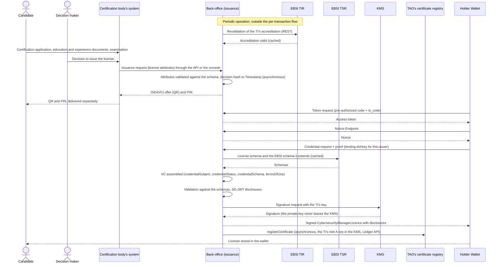
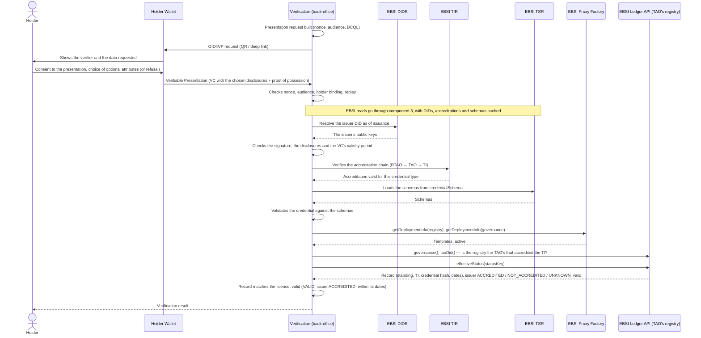
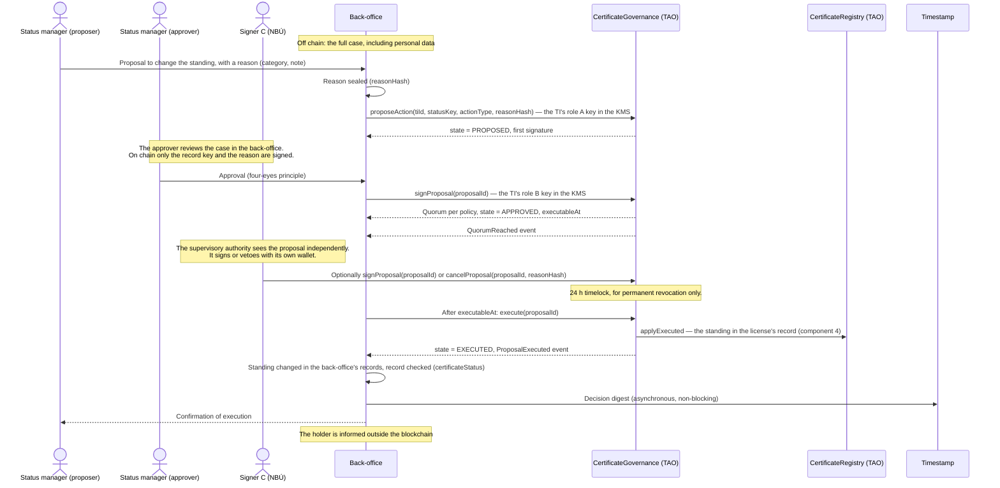
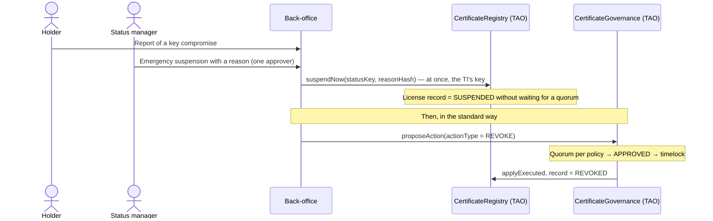

# Component Specification — Professional License Registry (EBSI MVP)

**Version:** 1.4
**Builds on:** Architectural Design v5.0

---

## Trust chain for the Slovak Republic — working variants

> **Status: working material, not an approved solution.**
> The two variants below are a basis for discussion, not a definitive design. Which institution takes the RTAO and TAO roles in the trust chain is not for the implementation team to decide. It is a matter for a formal decision of the institutions concerned and for negotiation on the terms of access to the EBSI infrastructure. Until this question is settled, development proceeds against the development EBSI service (component 3) and the EBSI pilot network.

### Background

The owner of the certification scheme for verifying the professional competence of a cybersecurity manager is NBÚ, which is also the supervisory authority under Act No. 69/2018 Coll. The current version 1.2 of the scheme, dated 12 January 2024, took effect on 1 February 2024. The knowledge standard for the role is set by Annex 5 of Decree No. 492/2022 Coll.

The certification itself is carried out by accredited conformity assessment bodies, which follow NBÚ's scheme and meet the requirements of the accreditation standard ISO/IEC 17024:2012. The certificate is issued by the conformity assessment body, not by NBÚ. These bodies are accredited by SNAS as the national accreditation body.

Competences are therefore split in three: NBÚ sets the content and rules of certification and supervises, SNAS assesses the competence of certification bodies, and the certification bodies certify and issue certificates.

### The question that comes before choosing an institution

EUROPEUM-EDIC is the legal entity taking over the governance tasks previously carried out within the European Blockchain Partnership. The Slovak Republic has been among its listed participants since 20 October 2026, as an observer. Further EU member states and EEA states may join, as members or as observers.

Technically more important than membership itself is which onboarding and governance mechanism is available to a Slovak public institution in EBSI's current production model, and who may issue the `VerifiableAuthorisationForTrustChain` for a Slovak RTAO. This must be verified before a variant is finally chosen.

### Variant A — NBÚ as RTAO, SNAS as TAO

```
EBSI trust chain                          National level (off chain)

RTAO    NBÚ                               NBÚ
        scheme owner, supervisory body    issues the certification scheme,
          │                               supervises
          │ VerifiableAccreditationToAccredit
          ▼
TAO     SNAS                              SNAS
          │                               accredits certification bodies
          │ VerifiableAccreditationToAttest   under ISO/IEC 17024
          ▼
TI      Certification bodies for persons  Certification bodies for persons
          │                               carry out the certification
          │ CybersecurityManagerLicence
          ▼
Holder  Cybersecurity manager
```

Accreditation in the EBSI trust chain creates a trust relationship within EBSI that digitally represents the existing national split of competences. **By itself, however, it neither replaces nor changes national accreditation** under the applicable legislation, which SNAS carries out. These are two parallel levels: EBSI represents trust digitally, the national system establishes it legally.

The variant mirrors the split of competences that applies today. NBÚ decides what is certified, the accreditation body assesses who is competent to certify. The model matches the examples in EBSI's documentation, where a national authority that authorises the trust chain acts at RTAO level, with a further TAO level below it.

**Weaknesses:** onboarding of two legal entities, the need for an agreement between NBÚ and SNAS, two separate setups of EBSI identities and keys, more governance dependencies. Running an EBSI TAO role is a new task for the accreditation service with no precedent from other domains; on top of that, SNAS would own the pair of contracts of components 4 and 10 and set up the certification bodies in it.

### Variant B — NBÚ as both RTAO and TAO

```
EBSI trust chain                          National level (off chain)

RTAO+TAO  NBÚ                             NBÚ — scheme and supervision
            │                             SNAS — national accreditation
            │ VerifiableAccreditationToAttest    of certification bodies
            ▼                                    (unchanged)
TI        Certification bodies for persons
            │
            │ CybersecurityManagerLicence
            ▼
Holder    Cybersecurity manager
```

The variant concentrates the EBSI trust-chain competences in one legal person. That can simplify onboarding and the management of EBSI identities and keys. NBÚ also supervises and owns the certification scheme in question, so its knowledge of the domain is greater than that of an institution entering EBSI only as an accreditation or technical actor. This does not mean that NBÚ certifies persons — accredited conformity assessment bodies do that.

The variant does not change the existing Slovak split of competences between the scheme owner, the accreditation body and the certification bodies. National accreditation under ISO/IEC 17024 remains with SNAS and is an off-chain precondition for admitting a certification body as a TI.

**Weaknesses:** the variant concentrates two EBSI trust-chain roles in one institution, even though the Slovak system keeps the scheme owner, the accreditation body and the certification bodies separate. Such a configuration therefore needs a separate assessment of impartiality, conflict of interest and compatibility with the requirements for accrediting certification bodies. It must also be shown that NBÚ can hold both roles in EBSI. NBÚ would moreover administer, as TAO, the contracts in which it signs as signer C itself.

### Which variant for the pilot

**Pilot baseline: Variant A.** It is the cleanest representation of the existing Slovak competence model and matches the hierarchy that EBSI documents.

**Variant B: an open feasibility question.** It is an experimental configuration whose admissibility must be explicitly confirmed by EBSI or EUROPEUM-EDIC. EBSI does allow one legal person to participate in several trust chains with different roles, but that is not the same as confirming that it may hold both RTAO and TAO in the same branch of a trust chain. This decision belongs to governance, not to the project team.

A comparable Portuguese solution for educational credentials uses a multi-level trust chain with the national government as RTAO, DGES as TAO and Universidade de Aveiro as TI. The example shows that multi-level participation of public institutions is feasible in the EBSI architecture, but it also requires coordinating several legal entities. The Universidade de Aveiro team's publication reports that, because of administrative and bureaucratic obstacles in integrating government bodies, the trust-chain implementation was adapted to a more achievable scope; it is a non-peer-reviewed preprint, so we take this finding as an indication, not as evidence.

### Link to components 4 and 10

Each TAO has its own pair of contracts: the certificate registry (component 4) and the governance contract (component 10), serving all its TIs. The back-office deploys the pair on behalf of the RootTAO through EBSI's Proxy Factory, and the TAO, acting with any key of its DID, sets up the TAO's TIs with it. Choosing the institution in the TAO role therefore also chooses who administers these contracts.

The institution in the RTAO role is a candidate for the external signer in the Certificate Governance Contract, if its legal and governance competences fit the role. Signer C is that institution's DID (a cosigner): any of its keys that the DID Registry lists signs. Linking the RTAO role with the signer role is not an automatic consequence of the EBSI trust-chain model and must be confirmed within the governance of component 10, including an assessment of powers, security and availability of the key infrastructure.

### Note on the names of accreditation credentials

The names `VerifiableAccreditationToAccredit` and `VerifiableAccreditationToAttest` belong to the RTAO → TAO → TI model, in which accreditations are stored in the TIR as Verifiable Credentials. The implementation uses them as EBSI's pilot network names them (Trusted Issuers Registry v5, the Verifiable Accreditation Record schema); they must be checked again when moving to another version of the EBSI API.

### Note on the holder identifier

The choice of the holder's DID method (e.g. `did:key`) is a separate technical design point, not part of the choice between variants. The EBSI DID Registry concerns registered legal entities in the trust chain; a holder as a natural person does not belong in this category and is not registered in the DIDR.

The holder has one `did:key` (EBSI profile, `jwk_jcs-pub`), derived from a 12-word security phrase; the wallet never sends it to anyone. A license is bound to a binding `did:key` that the wallet derives from the phrase separately for each issuer; it leads neither to the wallet's DID nor to the binding key used with another issuer.

### Open questions

1. What are the terms of access of the Slovak Republic to the EBSI infrastructure, and which onboarding profile is available to a Slovak entity
2. Who may issue the `VerifiableAuthorisationForTrustChain` for a Slovak RTAO
3. Whether and how the RTAO/TAO role in EBSI should be tied to the legal identity of NBÚ as a whole or to its individual statutory functions, in particular that of certification scheme owner
4. Whether it is legally and organisationally admissible for NBÚ to hold both the RTAO and the TAO role in EBSI (Variant B)
5. Which certification bodies are willing to join the pilot as Trusted Issuers
6. Whether further roles under Act No. 69/2018 Coll., such as the cybersecurity auditor, will be included in the trust chain, or only the cybersecurity manager
7. Whether the institution in the RTAO role is willing to act as an on-chain signer under component 10

---

## Environment profile and API versions

EBSI distinguishes several environments; the specification must not implicitly bind itself to one of them. The back-office speaks two shapes of the EBSI APIs, chosen by configuration: as the pilot network serves them today (the default), or as the Core API v1 of EBSI's documentation. Target environment and API versions for this iteration:

| Item | Value |
|---|---|
| Target environment | Pilot |
| Authorisation API | v4 (a presentation per the scope's presentation definition); in Core API v1, `/v1/auth` with OpenID4VP 1.0 and DCQL |
| DID Registry | v5 |
| Trusted Issuers Registry | v5 |
| Trusted Schemas Registry | v3 |
| Ledger API | v4 (`/ledger/v4/blockchains/besu`): writing to and reading the contracts of components 4 and 10; in Core API v1, `POST /v1/ledger` |
| Registry writes | a transaction signed in the KMS, sent through the registry's JSON-RPC `sendSignedTransaction` (pilot) or through the Ledger API (Core API v1) |
| Timestamp | transactions to EBSI's Timestamp contract (commit and reveal, with a salt) |
| Trusted Policies Registry | the `ProxyFactory:deployProxy` policy for the RootTAO |
| Smart Contracts Factory | Proxy Templates Registry and Proxy Factory: the `CertificateRegistry` and `CertificateGovernance` templates, a pair deployed for each TAO |
| VC data model | VCDM 1.1, `jwt_vc`, EBSI `VerifiableAttestation`; selective disclosure with SD-JWT |
| Issuance and presentation | OpenID4VCI 1.0 (`tx_code`, Nonce Endpoint), OpenID4VP 1.0 with DCQL and `direct_post`; W3C VC-API phone to phone |
| License status | a record on the component 4 registry that belongs to the issuing TI's TAO (`PlrLedgerStatusEntry`); no status lists |
| Holder DID method | `did:key`, EBSI profile with codec `jwk_jcs-pub`, derived from the phrase; licenses bound to a binding `did:key` per issuer |

## Component overview

Components 1, 2, 3 and 6 form one back-office: an API service (which also serves the console and the public protocol endpoints) and a background worker, over PostgreSQL, Redis and the KMS. The component numbers are stable identifiers, also where they are cited elsewhere.

| # | Component | Location | External communication |
|---|---|---|---|
| 1 | Back-office | Internal; only the endpoints for the wallet, verifiers and organization registration are public | OID4VCI, OID4VP, encrypted wallet backup, Verifier API |
| 2 | Issuance (Issuer Service) | Back-office module | OID4VCI 1.0 → Holder Wallet |
| 3 | EBSI integration (EBSI Integration Gateway) | Back-office module | HTTPS/JSON-RPC → EBSI APIs, registries and contracts |
| 4 | License status (`CertificateRegistry`) | On chain, one registry per TAO | EBSI Ledger API |
| 5 | Holder Wallet (Atest Wallet) | External (holder's device) | OID4VCI, OID4VP, W3C VC-API, EBSI APIs |
| 6 | Verification (Verifier Service) | Back-office module; public endpoints | OID4VP, W3C VC-API, HTTPS → EBSI, Ledger API |
| 7 | EBSI registries (DIDR / TIR / TSR / TPR) and the Smart Contracts Factory | External infrastructure | — |
| 8 | EBSI Authorisation API | External infrastructure | — |
| 9 | EBSI Timestamp | External infrastructure | — |
| 10 | Certificate Governance Contract (multisig, `CertificateGovernance`) | On chain, one per TAO, with its TIs | — |

For development, a development EBSI service stands in for components 7 to 9: it serves the EBSI APIs in both shapes over EBSI's registry contracts on a local Besu network.

---

## 1. Back-office

**Responsibility:** administering the license lifecycle and the decision process.

**Functions:**
- Records of issued licenses and their attributes (encrypted at rest). Applications, documents and examination results are kept by the certification body in its own systems, which request issuance through the registry's API or in the console
- Role management:
  - administrator — manages operator accounts, their groups and roles; no access to licenses
  - issuer — issues licenses and hands offers to holders
  - status manager — proposes and approves suspension, revocation and reinstatement, suspends at once
  - verifier — asks holders for presentations in the console and reads the results
  - auditor — reads the audit log, the anchored decisions and the cases, obtains pre-images to verify proposals on chain; changes nothing
  - RootTAO and TAO — manage the trust chain below them

  A TI's account receives the issuer, status manager and verifier roles at registration. The contract's signer roles A, B and C are separate from account roles (component 10.2)
- Authority is registry-wide: issuers, status managers and auditors see the licenses of every TI, and any two different status managers can decide on any license; the back-office then signs with the keys of the TI that issued it. The installation thus trusts each TI's staff with the licenses of all TIs
- Trust-chain management: the RootTAO appoints TAOs and a TAO appoints TIs, each by its own DID; a TAO accredits TIs for schemas that the back-office reads from the TSR (component 7); an accreditation has an end date and can be revoked, which withdraws everything the TI issued
- Deploying the pair of component 4 and 10 contracts for each TAO once EBSI confirms it (component 4.5), and setting up each TI in its TAO's governance contract
- Technically enforced separation of duties (four-eyes principle) — the second approver ≠ the proposer, checked in the application and the database
- Immediate suspension according to place in the trust chain: a TI its own licenses, a TAO those of its TIs, the RootTAO all of them
- Signing with keys in the KMS; only the service account signs, and a blockchain transaction only when it matches a decision the back-office recorded beforehand (component 3.4)
- Running verification (component 6) and the storage of encrypted wallet backups, which contain no holder DID
- An append-only audit log with hash chaining

**Outgoing communication:**
- → EBSI Authorisation API: tokens for writes (component 8)
- → EBSI Ledger API: a license's record after collection, immediate suspension, a proposal and the signatures of roles A and B, execution after the timelock (components 4 and 10), deployment of a TAO's contracts through the Proxy Factory
- → EBSI Timestamp: a decision's digest (component 9)
- → EBSI DIDR, TIR, TSR: reads; reserving and revoking an accreditation attribute on behalf of the accrediting organization

**Incoming communication:**
- ← Operator console
- ← Holder Wallet: OID4VCI (metadata, offer, token, nonce, credential), OID4VP (request object, response), encrypted backup
- ← Appointed organization: account registration from an invitation
- ← Third parties: the Verifier API with a key

### 1.1 License state machine

```
ACTIVE
  ├── suspend   → SUSPENDED   (reversible)
  └── revoke    → REVOKED     (irreversible)

SUSPENDED
  ├── reinstate → ACTIVE
  └── revoke    → REVOKED

REVOKED
  └── terminal state

EXPIRED is not written; the verifier derives it from validUntil in the registry's record
```

The `reinstate` transition is allowed only from `SUSPENDED`. There is no way back from `REVOKED` — regaining the authorisation means issuing a new credential with a new identifier and a new license number (a TI assigns each number once).

### 1.2 Sensitive links and logging

The back-office is the only place where a holder is linked to their license. On chain, a license's record is kept under a key derived from the TI's DID and the license identifier (component 4.1); the license number does not go on chain. These links stay non-public: the internal holder identifier (`holder_reference`), the license's attributes, a reason's salt and note, and the link between a case and its proposal on chain. They must be access-controlled, audited and encrypted at rest, and must not reach logs. The back-office keeps no holder DID.

**Never log:** the holder DID, the full VC payload, reason salts, the pre-authorized code and the offer's PIN, private keys, the credential's `proof`, the OID4VP presentation, personal documents.

**May be logged:** request ID, internal pseudonymised credential ID, proposal ID, transaction hash, timestamp ID, EBSI API operation name, HTTP status, latency, schema ID, issuer DID.

---

## 2. Issuance (Issuer Service)

**Responsibility:** issuing signed Verifiable Credentials.

**Functions:**
- Accepting an issuance request (registry API or console) and validating the attributes against the schema
- Cached revalidation of the TI's accreditation in the TIR (periodic; with a bounded grace period when the TIR is unavailable)
- License schemas from the TSR by the identifiers in the configuration; the back-office loads them at startup and, at every issuance, validates the license against the current version together with the EBSI schema it extends
- Putting into the credential a `credentialStatus` pointing to the registry of the issuing TI's TAO, the TI's accreditation (`termsOfUse`) and three schemas (see 2.2)
- Selective disclosure: every attribute of `credentialSubject` except `id` and `licenceNumber` is signed as the digest of an SD-JWT disclosure
- Signing the credential (ES256) with the issuing TI's key in the KMS, which the TI lists in its DID document as `assertionMethod`; each TI is an issuer in its own right, with its own `did:ebsi`
- Dates according to EBSI's rules: `issued` is the signing instant (the JWT's `iat`), `issuanceDate` equals `validFrom` (`nbf`), `expirationDate` (`exp`) three years later by default, as NBÚ's certification scheme sets the validity of a certificate
- OpenID4VCI 1.0: a pre-authorized code bound to one license, single-use, with an expiry, a 6-digit PIN (`tx_code`) and a limit of five attempts, after which the TI offers the license again; a nonce from the Nonce Endpoint and proof of the binding key (`proofs`)

### 2.1 License issuance sequence



The link between the internal record (`holder_reference`), the credential ID and the license number is stored only in the back-office. The record on the registry is created only after collection; an offer that nobody collects never reaches the ledger.

### 2.2 Structure of credentialStatus and credentialSchema

A license carries **three schemas** in `credentialSchema`: the license's own schema, the schema of its `credentialStatus` entry, and EBSI's type extension for `termsOfUse` of type `IssuanceCertificate`. The back-office and the wallet refuse a license in any other form.

```json
{
  "credentialSchema": [
    { "id": "https://api-pilot.ebsi.eu/trusted-schemas-registry/v3/schemas/[VC_SCHEMA]",
      "type": "FullJsonSchemaValidator2021" },
    { "id": "https://api-pilot.ebsi.eu/trusted-schemas-registry/v3/schemas/[STATUS_ENTRY_SCHEMA]",
      "type": "FullJsonSchemaValidator2021" },
    { "id": "https://api-pilot.ebsi.eu/trusted-schemas-registry/v3/schemas/z2yw1Mq2Cq4jN8B2bJ66cGcFEqjrJQUinxHAUjZTkVKjz",
      "type": "FullJsonSchemaValidator2021" }
  ],
  "termsOfUse": [
    { "id": "https://api-pilot.ebsi.eu/trusted-issuers-registry/v5/issuers/{issuerDid}/attributes/{attributeId}",
      "type": "IssuanceCertificate" }
  ],
  "credentialStatus": [
    {
      "id": "eip155:{chainId}:{contract}",
      "type": "PlrLedgerStatusEntry",
      "chainId": {chainId},
      "contract": "{contract}"
    }
  ]
}
```

A license has a single `credentialStatus` entry: the chain and address of the registry (component 4) that belongs to the issuing TI's TAO; suspension and revocation are both recorded in the same record. The entry does not carry the record's key: the verifier computes it from the issuer's DID and the license identifier (component 4.1). The verifier accepts the registry named in the license only if it is the registry of the TAO that accredited the TI (component 4.5). `chainId` identifies the EBSI ledger.

`[STATUS_ENTRY_SCHEMA]` is the schema of the `PlrLedgerStatusEntry` entry, a type extension that also extends EBSI's Verifiable Attestation (EBSI's own type extensions do not), so it validates a complete credential. It requires exactly one `PlrLedgerStatusEntry` and lets other status entries sit beside it; the registry itself issues only that one. `termsOfUse` points to the TI's accreditation in the TIR, where trust-chain verification starts. The license schema requires its mandatory attributes at issuance; on presentation, the verifier requires only those the holder shared, so a license with hidden attributes passes validation.

**Outgoing communication:**
- → EBSI TIR and TSR: accreditation revalidation, reading schemas
- → KMS: signing with the TI's key
- → Holder Wallet: OID4VCI (HTTPS, public internet)
- → The TAO's certificate registry: the record after collection (through component 3)

**Dependencies:** EBSI integration (component 3), KMS

---

## 3. EBSI integration (EBSI Integration Gateway)

**Responsibility:** the back-office's single point of communication with the EBSI infrastructure; isolating the domain layer from EBSI API versions.

**Functions:**
- Two shapes of the EBSI APIs, by configuration: the pilot network (default) or Core API v1
- **Obtaining and renewing access tokens** from the EBSI Authorisation API; the scope depends on the target operation (see component 8). The token for contract calls (`ledger_invoke`) needs the organization's `VerifiableAuthorisationToInvoke`
- Reading the DIDR (including a DID document as of a given instant), TIR, TSR and the Proxy Factory for verification and issuance, only under the configured EBSI API roots, without following redirects
- Checking an appointed organization: its DID document lists the keys the back-office created for it, and its accreditation is in the TIR (see 3.1)
- Reserving and revoking an accreditation attribute in the TIR on behalf of the accrediting organization (`setAttributeMetadata`)
- Transactions through the Ledger API: deploying a TAO's pair of contracts through the Proxy Factory, setting up a TI in the governance contract (`addTi`), calls to the component 4 and 10 contracts (`registerCertificate`, `suspendNow`, `proposeAction`, `signProposal`, `execute`, `cancelProposal`), reading `certificateStatus` and a proposal's state
- Writing decision digests to Timestamp (commit and reveal, see component 9)
- Following the state of proposals and records by polling, not by subscribing to events

### 3.1 Two-phase onboarding of TAOs and TIs

An organization cannot register itself in the trust chain — it must be invited by an accreditation organization (RTAO or TAO). Each organization brings its own `did:ebsi`, which it registered in the DID Registry with its own wallet; the back-office does not create its DID and does not write to the DIDR or the TIR on its behalf.

```
Phase 1 — Invitation (carried out by the RTAO/TAO in the back-office):
  Appointing the organization by its DID (the DID must be in the DIDR)
  setAttributeMetadata → reserving an attribute in the TIR (reservedAttributeId)
  Issuing the accreditation VC with reservedAttributeId, accreditedFor and termsOfUse
  Handing the VC to the candidate together with the invitation to the registry

Phase 2 — Acceptance (carried out by the invited organization with its own wallet):
  Registering an account in the back-office; the back-office creates its keys in the KMS
  Adding these keys to its own DID document (by purpose)
  Obtaining an access token with scope tir_invite
  setAttributeData at the position from reservedAttributeId → sendSignedTransaction
  Check in the back-office ("Skontrolovať v EBSI", Check in EBSI): keys in the DID document, accreditation in the TIR
```

Only after the check does the back-office act for the organization: for a TAO it deploys the pair of contracts (component 4.5), for a TI it sets the TI up in its TAO's governance contract (`addTi`) with the TI's role A and B keys. Phase 2 is the organization's own act; for development, a development wallet plays the organization's wallet.

The type of accreditation credential depends on the invited organization's role:

```
RTAO → TAO :  VerifiableAccreditationToAccredit
TAO  → TI  :  VerifiableAccreditationToAttest
```

The RTAO is onboarded differently — it is accredited directly by EBSI and obtains a `VerifiableAuthorisationForTrustChain`, and only then registers in the TIR.

An organization may participate in several trust chains with different roles; each participation can be revoked separately.

### 3.2 Role terminology in the TIR API

This document uses the names RTAO, TAO and TI, which match EBSI's conceptual model. **The API, however, returns different values** — the `issuerType` field in the TIR contains `RootTAO` (not `RTAO`), together with the `tao` and `rootTao` fields referring to the respective DIDs. The implementation must work with the values the API returns, not with this document's conceptual abbreviations.

### 3.3 Known breaking changes of the TIR API v5

Since the release of 30 June 2025:

- The `/issuers/:did` endpoint **no longer returns the `attributes` field** — it is now a link to `/issuers/:did/attributes`. An issuer's attributes must be read from that separate endpoint.
- The response contains a new `hasAttributes` field (`true` if the Trusted Issuer has accepted at least one attribute).

The integration must take these changes into account both when revalidating an accreditation and when verifying a trust chain. Contract tests against the target API version are therefore a mandatory part of the implementation.

### 3.4 Boundary between the integration and the key infrastructure

The integration orchestrates calls and transactions but holds no signing keys. A private key must never be in the application's configuration.

```
EBSI integration                KMS (AWS KMS), each organization's keys by purpose
 ├── access token orchestration    ├── credential signing (P-256, assertionMethod)          (TI)
 ├── EBSI API adapter              ├── DID authentication                                    (every organization)
 └── transaction orchestration     ├── ledger transactions (secp256k1, capabilityInvocation) (every organization; the TAO's key owns the contracts)
                                   ├── timestamp transactions                                (registry)
                                   └── governance role A / role B                            (every TI)
                                   Signer C: the supervisory authority's keys, outside the installation
```

Keys must be logically separated by purpose. EBSI's DID documentation advises against using one key both to update the DID document and to sign credentials. Physical separation into separate HSM partitions is not necessary; logical separation is.

The back-office uses an organization's key only once the organization lists it in its DID document for that purpose. It first records each transaction (contract, function with arguments, chain, zero value) and signs only that, once. Keys are rotated in two steps — a new key first appears in the DID document, and only then is it put into service — and the old key stays in the document's history, so licenses it signed remain verifiable; a verifier reads the DID document as it stood at the license's issuance instant and, if reading the history fails, never substitutes the current key.

**Outgoing communication:**
- → EBSI Authorisation API: access token requests
- → EBSI registries (DIDR/TIR/TSR): HTTPS REST (read), JSON-RPC or Ledger API (write)
- → EBSI Timestamp: commit and reveal transactions, asynchronous, non-blocking (a digest, never the original data)
- → The component 4 and 10 contracts and the Proxy Factory: transactions through the EBSI Ledger API, reading state

**Incoming communication:**
- ← The other back-office modules: internal calls

**Implementation note:** no other back-office module calls EBSI directly, verification included. The wallet's verifier (component 5) reads EBSI itself, to verify a license without the back-office.

---

## 4. License status (record on the registry)

**Responsibility:** recording the validity of every collected license so that a verifier reads it from the ledger without the issuer's server. The single source of truth about a registry license's status is its record in the `CertificateRegistry` contract, which only the component 10 governance contract and an immediate suspension change.

### 4.1 The license's record

```solidity
struct Certificate {
    Standing standing;        // NONE | VALID | SUSPENDED | REVOKED
    uint64   validFrom;
    uint64   validUntil;      // 0 = no end of validity
    uint64   registeredAt;
    uint64   changedAt;
    bytes32  credentialHash;  // SHA-256 of the signed JWT without disclosures
    string   issuerDid;       // did:ebsi of the issuing TI
}
```

The record's key:

```
certificateIdHash = SHA-256(abi.encode("PLR-CERTIFICATE-ID-V1", certificateId))
statusKey         = SHA-256(abi.encode("PLR-CERTIFICATE-V4", issuerDid, certificateIdHash))
```

`certificateId` is the license's random `urn:uuid`. The contract computes the key itself, so a TI can only write the key of its own license, and keeps one record per license. A verifier computes the key from the presented license (or with the contract's `computeStatusKey(issuerDid, certificateId)`; a public RPC node, however, sees what it is given) and reads `certificateStatus(statusKey)`.

`credentialHash` is SHA-256 of the signed JWT as the TI issued it, that is, everything before the first `~` of the SD-JWT. It is the same in every presentation, whatever attributes are shared. A stolen signing key therefore cannot put another holder or other attributes under the identifier of a real license, as long as the keys that write to the registry are safe.

### 4.2 Writing

- `registerCertificate(certificateIdHash, issuerDid, validFrom, validUntil, credentialHash, standing)` — one signature of one of the TI's own keys (the back-office uses role A), never a cosigner's, once the holder collects the license. A license suspended before registration is registered as `SUSPENDED`. One revoked before registration is registered as `SUSPENDED` too and then revoked by an ordinary revocation proposal (quorum, timelock, veto): no record starts `REVOKED`. The contract checks in the TIR that the TI is accredited by the TAO that owns the registry.
- `suspendNow(statusKey, reasonHash)` — immediate suspension by one signature of one of the TI's own keys, never a cosigner's (the supervisory authority's included); suspends only a valid license and requires a reason (component 10.6). It works after the TI lost its accreditation, so that it can withdraw its licenses.
- An executed proposal (component 10.5) sets the standing in the same transaction (`applyExecuted`): suspension gives `SUSPENDED`, reinstatement `VALID`, revocation `REVOKED` for good. An action is proposed and executed only if it changes the standing: suspension of a valid license, reinstatement of a suspended one, revocation of either. Nothing is proposed for a revoked license, and a proposal the standing has overtaken (a suspension after `suspendNow`) counts as expired.
- The back-office writes asynchronously right after collection, an immediate suspension or a change of status. A periodic check catches up with anything not written. A change to a record made outside the back-office is not reverted, only logged.

### 4.3 Reading

- The verifier first checks the `credentialStatus` entry: its `chainId` is the EBSI ledger's, its `id` is `eip155:<chainId>:<contract>` for its own chain and contract, and the registry it names belongs to the TAO that accredited the TI (component 4.5). The status entry schema requires the entry but cannot express these three checks.
- The contract does not compare `validUntil` with the time; the verifier does (`EXPIRED`, `NOT_YET_VALID`).
- The verifier compares the record with the license (TI, `credentialHash`, `validFrom`, `validUntil`) and refuses the license if they differ. Only `VALID` passes; `SUSPENDED` and `REVOKED` are both refusals.
- A record that cannot be read within 30 s, or is not written yet, is `STATUS_UNAVAILABLE`, never `VALID`. There is no fallback source of status.

### 4.4 Status lists outside the registry

Registry licenses use no status lists. StatusList2021 with a status proxy in the TIR concerns only credentials outside the registry; the registry issues none and registers no status proxy.

### 4.5 One registry per TAO

Each TAO has its own pair of `CertificateRegistry` and `CertificateGovernance` contracts, serving all its TIs:

- **Deployment.** When EBSI confirms a TAO, the back-office deploys its pair through EBSI's Proxy Factory from the `CertificateRegistry@1` and `CertificateGovernance@1` templates. The transactions are signed by the RootTAO's key, which holds the `ProxyFactory:deployProxy` policy in the Trusted Policies Registry. Deployment can be repeated: the addresses derive from the TAO's DID, so an interrupted deployment resumes where it stopped.
- **Authority.** The governance contract has no owner: the TAO is its DID, and any key the DID Registry lists for it acts as the TAO, so a rotated key loses that power at once. The TAO's key links the registry to governance once, at deployment (`setGovernance`), which ends the registry's ownership; neither contract can be repointed afterwards. The TAO sets up each of its TIs in the governance contract (component 10.2).
- **The first pair**, deployed together with the installation, belongs to the TAO its governance contract names.
- **Trust rule.** A verifier (in the back-office and in the wallet) keeps no list of registries. It accepts the registry named in a license when, according to the Proxy Factory (`getDeploymentInfo`), it was deployed from the registry template and is active, its `governance()` was deployed from the governance template, the two contracts name each other, and the governance contract's `taoDid()` is the TAO that accredited the issuing TI in the TIR. A new TAO therefore needs no new configuration and no new wallet build.

Every license, case and immediate suspension of a TI goes to its TAO's pair.

---

## 5. Holder Wallet

**Responsibility:** managing the holder's keys; receiving, storing, presenting and verifying credentials.

**Implementation:** Atest Wallet, the registry's own mobile application for Android and iOS (React Native), published under the MIT License. Its interface is in Slovak and English; it names a license's attributes in the words of its schema.

**Functions:**
- Identity from a 12-word security phrase: the same `did:key` (EBSI profile for natural persons, codec `jwk_jcs-pub`) on any phone. The identifier is not registered in the EBSI DID Registry, and the wallet never sends it to anyone
- A binding `did:key` per issuer, derived from the phrase (HKDF); it signs the proof at issuance and the presentations
- Receiving a credential offer through OpenID4VCI 1.0 (pre-authorized code with `tx_code`, a nonce from the Nonce Endpoint)
- Creating a Verifiable Presentation through OpenID4VP 1.0 with the holder's consent; the request is a DCQL query, the fields the verifier requires are locked, the others the holder shares only by choice (SD-JWT). A refusal is reported to the verifier at once (`access_denied`)
- Phone-to-phone presentation according to the W3C VC-API, through a local server on the phone, encrypted and without the back-office; both phones must be on the same Wi-Fi
- Verifier: the same application verifies a license itself, reading the DIDR, TIR, TSR, the Proxy Factory and the registry through the EBSI Ledger API
- Reads the status of stored licenses from the registry the license names, after checking that it belongs to the license's TAO
- Encrypted backup of the licenses in the back-office, without the holder's DID; restoring from the phrase brings back the same DID and the licenses. When the back-office is unavailable, a restore changes nothing and reports maintenance
- Organization profile: a TI can issue licenses straight from the wallet; the sign-in with the account password lasts 15 minutes and ends when the wallet locks
- Locking: going to the background locks the wallet on every screen

**Holder onboarding:** the holder needs no registration in EBSI. Steps: install the wallet → set a PIN → generate the security phrase and from it the DID and keys → store them in the device's secure storage (iOS Keychain, Android Keystore). On a new phone, the wallet is restored from the phrase.

**EBSI Wallet Conformance:** EBSI's tests (WCT v3) check earlier drafts of OID4VCI and OID4VP in EBSI's profile (`user_pin`, `presentation_definition`). The wallet and the back-office use the 1.0 versions only, so passing those tests needs either EBSI's tests moving to the 1.0 versions or an additional draft profile.

**Choice of implementation:** we assessed existing, preferably open-source solutions with a technology stack close to ours, including Holder wallets from the **EBSI Conformant Wallets** list. None of them met all the requirements of this component: a DID derived from the phrase that never leaves the phone, binding keys for individual issuers, license status from the record on the component 4 registry, selective disclosure in a JWT VC, phone-to-phone presentation without the back-office, and an encrypted backup without the DID.

**Implementations considered:**
- **Triveria** — a commercial SDK with a mobile wallet; Triveria Wallet 1.0 has an EBSI Conformance Test Report (EBSI specifications v3.0.0, 15 January 2024). The SDK covers wallet creation, onboarding and accreditation into a trust chain, and issuance and verification through one interface, with selective disclosure on the holder's side. Proven in an academic deployment (Universidade de Aveiro, issuing diplomas through EBSI). The license terms are not public — they must be checked with the vendor directly. Load testing of the cited deployment ran into the vendor API's rate limit at about 300 concurrent users.
- **walt.id (waltid-identity, Wallet API)** — Apache 2.0, an actively maintained open-core stack with a ready wallet (issuer/verifier/wallet APIs + UI applications). It has an EBSI Conformance Test Report (walt.id v0.3.0, EBSI specifications v3.0.0, 15 April 2024). A proven record of deployments in the EBSI context (EBSI4RO, EBSILUX, CroEduPass). Its documentation lists support for StatusList2021, Bitstring Status List and Token Status List.
- **The `@cef-ebsi/*` family of libraries** (`wallet-lib`, `verifiable-credential`, `did-auth`, `key-did-resolver`) — official, low-level building blocks straight from EBSI's open-source repository (EUPL), not a ready wallet. They provide DID generation and VC/JWT handling, but the OID4VCI/OID4VP flows, UI and key storage must be built on top. `did-auth` is moreover explicitly marked experimental. Better suited to checking or complementing the behaviour of a ready implementation than to replacing it.

**Outgoing communication:**
- → Back-office: OID4VCI, OID4VP (HTTPS/QR, public internet), encrypted backup
- → EBSI (DIDR, TIR, TSR, Proxy Factory, Ledger API): when verifying and reading license status

**Incoming communication:**
- ← Back-office: OID4VCI responses
- ← Back-office verification or another phone: a presentation request according to the W3C VC-API (local network)

---

## 6. Verification (Verifier Service)

**Responsibility:** verifying the validity, authenticity and status of a presented credential.

**Implementation:** verification runs in the back-office, which also conducts the OID4VP conversation with the wallet. The wallet's verifier (component 5) applies the same rules.

**Functions:**
- Building the presentation request: nonce, audience and a DCQL query with the required and optional attributes and the combinations the verifier accepts
- Validating the signature, the schemas and the validity period
- Resolving the issuer DID (DIDR) as it stood at the credential's issuance instant
- Checking the SD-JWT disclosures against the digests the issuer signed
- Verifying the accreditation chain (TIR)
- Verifying conformity with the schemas (TSR)
- Checking that the registry named in the license belongs to the issuing TI's TAO (Proxy Factory and TIR, component 4.5)
- Reading the license's record from the registry through the EBSI Ledger API and comparing it with the license (component 4)
- Holder binding, replay protection
- Connecting to the holder's wallet according to the W3C VC-API after scanning its QR code
- Accepting the holder's refusal (OpenID4VP `access_denied`) as the final answer to a request

**Output states:** `VALID`, `SUSPENDED`, `REVOKED`, `EXPIRED`, `NOT_YET_VALID`, `UNTRUSTED_ISSUER`, `INVALID_SIGNATURE`, `STATUS_UNAVAILABLE`, `INDETERMINATE`; a request the holder refused ends as `declined`.

**Outgoing communication:**
- → EBSI registries (DIDR/TIR/TSR) and the Proxy Factory: HTTPS through component 3
- → EBSI Ledger API: reading the record on the registry (the verifier's identity stays hidden from the issuer)
- → Holder's wallet: W3C VC-API

**Incoming communication:**
- ← Holder Wallet: OID4VP (`direct_post`), a response according to the W3C VC-API

**Interfaces:** the Verify tab in the console (verifier role), the QR/mobile flow, the Verifier API with a key for external systems (verifying one credential, an OID4VP request, connecting to a wallet's invitation), the verifier in the wallet. Verifiers are not registered: the request carries the registry's DID as the technical verifier and does not name the party asking.

### 6.1 Verification sequence



If the record cannot be read within 30 s or is not written yet, the result is `STATUS_UNAVAILABLE` — never `VALID`.

### 6.2 Responsibilities when checking the record

- The record is read from the registry the license names only if the Proxy Factory and the TIR confirm it as the registry of the issuing TI's TAO (component 4.5); otherwise the result is `STATUS_UNAVAILABLE`
- **The record must be the license's own** — `issuerDid`, `credentialHash`, `validFrom` and `validUntil` must match; a mismatch is grounds for refusal (`INDETERMINATE`). A license therefore cannot borrow another's standing, slip other content under a real license's identifier, or outlive the dates the registry recorded
- Only `VALID` passes; `SUSPENDED` and `REVOKED` are refusals, and after `validUntil` the result is `EXPIRED`
- **The issuer must be accredited now** — `effectiveStatus` returns, with the record, whether the issuing TI is accredited by the rule of `isActiveTi`: `ACCREDITED`, `NOT_ACCREDITED`, or `UNKNOWN` when the check could not be made. Its `valid` holds only for `VALID`, `ACCREDITED` and now within the record's dates. `NOT_ACCREDITED` and `UNKNOWN` are never valid. `certificateStatus` stays the raw record
- A record that cannot be read or does not exist yet is `STATUS_UNAVAILABLE`, never `VALID`; there is no fallback source of status
- Caching applies to DID documents, accreditations, schemas and trust in a registry, not to a license's standing

### 6.3 Definition of the VALID result

```
VALID =
      the VP is valid
  AND the VC's signature is valid
  AND the issuer DID resolves and the key was valid at issuance
  AND the disclosures match the digests the issuer signed
  AND the VC's validity period holds
  AND holder binding is verified
  AND the issuer's accreditation is valid for this credential type
  AND the credential conforms to its schemas
  AND the record is available on the registry of the TAO that accredited the issuer
  AND the record belongs to this license
  AND the record's standing is VALID
```

Failing any condition means a result other than `VALID`. `STATUS_UNAVAILABLE` is not just a technical error — it means the system cannot decide on validity with sufficient certainty. In a security application it must never be read as `VALID`.

---

## 7. EBSI registries (DID Registry / Trusted Issuers Registry / Trusted Schemas Registry)

**Responsibility:** shared European trust infrastructure; outside the implementation team's control.

**Registries provided (relevant to the MVP):**
- **DIDR** — DID documents, public keys
- **TIR** — the accreditation chain (RTAO → TAO → TI); no status endpoints are registered for registry licenses
- **TSR** — credential schemas

**Registries and services provided (contracts):**
- **Smart Contracts Factory** — a service that lets authorised participants deploy and manage their own contracts on the EBSI ledger from pre-approved templates (`hub.ebsi.eu/docs/smart-contracts`): the **Proxy Templates Registry** records the templates, and the **Proxy Factory** deploys instances from them and can tell, for each, which template it came from and whether it is active
- **Trusted Policies Registry (TPR)** — manages the permissions to deploy (`ProxyFactory:deployProxy`) and to access deployed contracts
- **Trusted Contracts** — the contracts that can be called with a `ledger_invoke` token; instances deployed by the Proxy Factory are among them

**Access:** through component 3 (verification included) and directly from the verifier in the wallet.

**Registry interfaces:** REST for read operations, JSON-RPC for write operations (build an Ethereum transaction + `sendSignedTransaction`).

**Note on schema registration:** the JSON schema for `CybersecurityManagerLicence` cannot be registered self-service. The EBSI Support Office registers it on a submitted proposal; the proposal should come from a representative of the use case or domain, since EBSI registers only schemas recognised in their domain.

Documents required for registration:

1. Completed data model templates
2. The JSON Schema
3. **Confirmation from the domain's representatives that the schema is recognised in the domain**
4. An example credential, which a representative adds to EBSI's JSON Schema repository by a pull request, named `EA-v3-{cluster name}-{name of the example}.json`

**The registry's schemas.** Two schemas are to be registered: the license schema `CybersecurityManagerLicence` (19 attributes with labels, hints, default values and which are required, in English, aligned with NBÚ's certification scheme and the ECSF role profile Chief Information Security Officer; it extends EBSI's Verifiable Attestation for VCDM 1.1) and the schema of the `PlrLedgerStatusEntry` entry (`[STATUS_ENTRY_SCHEMA]` in section 2.2), which extends it too. Both use JSON Schema 2020-12 (`$schema` `https://json-schema.org/draft/2020-12/schema`), the only version the Schemas Registry accepts. The TSR forms a schema's identifier from its content without annotations, so fixing a label or a hint keeps the identifier; any other change is a new version with a new identifier.

**Schema management.** The back-office defines no schemas. It reads them from the TSR by the identifiers in the configuration; a new kind of license means registration with the Support Office and a configuration change. A type that no identifier names any more is no longer issued, but existing licenses of that type can still be verified. The console and the wallet name the attributes in the schema's words, in both interface languages.

**Existing EBSI schemas.** The trust chain and the base of the license use EBSI schemas already on the pilot network: Verifiable Attestation (VCDM 1.1), Verifiable Accreditation Record, Verifiable Authorisation and the type extension for `IssuanceCertificate`. Before defining another schema of its own, check the Data Models Inventory and the EBSI JSON Schema repository, for example `@cef-ebsi/vcdm1.1-ct-qualification-schema` for qualifications.

**Choice of data model.** The specification builds on VCDM 1.1 in `jwt_vc` format, which EBSI's conformance tests work with; the EBSI JSON Schema repository contains both `vcdm1.1-*` and `vcdm2.0-*` variants side by side. Selective disclosure of attributes uses SD-JWT directly in the JWT VC; the SD-JWT VC format (`dc+sd-jwt`) is not used.

---

## 8. EBSI Authorisation API

**Responsibility:** authorising access to EBSI services; issues the bearer tokens needed for write operations to registries and for contract calls.

**Protocol:** a token is requested by presenting a Verifiable Presentation. On the pilot network (Authorisation API v4), according to the scope's presentation definition; in Core API v1, through OpenID4VP 1.0 with DCQL. The back-office replaces a refused token once.

**Scopes used (pilot network names):**

| Scope | Use |
|---|---|
| `tir_invite` | Accepting an invitation into the trust chain (phase 2 of onboarding); used by the invited organization's wallet, with the accepted Verifiable Accreditation as proof |
| `tir_write` | Writes to the TIR: reserving and revoking an attribute by the accrediting organization |
| `didr_invite` / `didr_write` | Registering and updating a DID document; used by the organization's wallet |
| `ledger_invoke` | Calls to Trusted Contracts: the component 4 and 10 contracts and the Proxy Factory; the organization's `VerifiableAuthorisationToInvoke` is the proof |
| `timestamp_write` | Writing to Timestamp (component 9) |

The back-office uses neither `tsr_write` nor `tpr_write`: the Support Office registers schemas, and EBSI sets the policies in the TPR. The exact scope names and the conditions for granting them depend on the API version in the environment profile and must be verified before production deployment. Some scopes (e.g. `tnt_authorise`) are granted only to holders of the corresponding policy in the TPR — the same mechanism applies to `ProxyFactory:deployProxy`.

**Incoming communication:**
- ← EBSI integration (component 3): access token requests

**Implementation note:** every write operation to the registries and every contract call is refused without a valid token. The integration must renew tokens before they expire and handle authorisation failures.

---

## 9. EBSI Timestamp

**Responsibility:** cryptographic proof that timestamped content existed at a given time.

**Principle:**
```
Decision (in the back-office, including personal data, encrypted at rest)
    ↓  canonical serialisation: "PLR-DECISION-V1|" + JSON with sorted keys, no whitespace
    ↓  SHA-256
Digest
    ↓  EBSI Timestamp contract: commit (a commitment with a salt), then reveal once it matures
EBSI ledger
```

Only the project-defined cryptographic digest is sent to EBSI, never the decision itself or personal data. This property follows from the design of the integration, not from a limitation of the API — Timestamp works with a data payload and also returns a `data` field when read. **Before production deployment, it must be verified against the specific Timestamp API version, and in a test environment, that nothing beyond the digest reaches EBSI.**

**Functions:**
- Writing a timestamped digest for every decision (issuance, an executed change of status — suspension, revocation, reinstatement —, an immediate suspension, and the withdrawal of licenses when an accreditation is revoked)
- Reading and verifying an existing record: the back-office recomputes the digest from its copy of the decision and compares it with the ledger (the Audit tab in the console)

**Incoming communication:**
- ← EBSI integration (component 3): a decision's digest, asynchronous, non-blocking for issuance and changes of status

**Availability status:** an EBSI core service. Its version and availability must be tied to the target environment (Pilot / Pre-production / Production) — see the environment profile at the start of the specification.

**Place in the architecture:** part of the standard audit trail, not of the verification critical path — writing status to the registry and verification work independently of its availability (an asynchronous write never blocks issuing or verifying a license).

---

## 10. Certificate Governance Contract (multisig)

> **Custom EBSI extension — subject to EBSI governance approval.**
> This is not a standard EBSI revocation component but custom smart contracts on top of EBSI. EBSI is a permissioned network and contract deployment is not freely allowed — it goes through the **Smart Contracts Factory**, which lets authorised participants deploy and manage contracts on the EBSI ledger **only from pre-approved templates** (10.0). The back-office writes to the contracts and verifiers read from them through the EBSI Ledger API.

**Responsibility:** independently verifiable proof that a change in a license's standing was approved by a quorum of several independent actors. The `CertificateGovernance` contract holds each TI's signers, roles, rules and proposals; an executed proposal sets the standing in the record of the `CertificateRegistry` (component 4), which is the single source of truth about a license's status.

### 10.0 Deployment through the Smart Contracts Factory

EBSI's documentation distinguishes four steps. For our contracts, which do not exist among the approved templates, the whole path applies:

```
1. Use an Existing Smart Contract Template
   → check whether an approved template already covers our case

2. Propose a New Template
   ├── Design a Smart Contract Template   (design according to EBSI's specifications)
   └── Submit a Smart Contract Template   (submission for review and approval)

3. Deploy a Template
   → deploying instances of the approved templates on the ledger (a pair per TAO, component 4.5)

4. Grant Access to a Deployed Template
   → managing access rights to the deployed instances
```

Step 1 is the mandatory first action — if an existing template covered multisig governance, the whole approval process would fall away.

Both contracts run behind beacon proxies, so they can be upgraded to a new implementation version without renumbering proposals. The `CertificateRegistry` and `CertificateGovernance` templates are registered in the Proxy Templates Registry, which accepts a template only with the URI of an audit report and of a public repository. The EBSI registries the contract reads (DIDR and TIR) are immutable parts of the implementation, so no transaction can change them, not even with a compromised TAO key.

### 10.1 Classification against the EBSI framework

EBSI defines three types of revocation services: bound to Issuers, to Holders, or to the VC itself. Revocation in this design is **bound to the VC**: each license has its own record on the registry (component 4), which an executed proposal changes. It is neither a status list nor a CRL. The multisig decides on the change, the record carries it.

### 10.2 Participants and threshold

One governance contract serves all the TIs of one TAO. The TAO sets up each TI (`addTi`): its DID, its accreditation attribute in the TIR, its signer keys with their roles, its cosigners, four policies and the proposal lifetime. A TI is identified as `tiId = keccak256(did)`, and every proposal, signature and rule change names it.

| Role | Description | Key |
|---|---|---|
| Signer A | The certification body's decision maker | the TI's key in the KMS, listed in the TI's DID document (`capabilityInvocation`) |
| Signer B | The certification body's second approver, independent of A | the TI's key in the KMS, listed in the TI's DID document |
| Signer C | Representative of the supervisory authority (NBÚ), external to the certification body | cosigner: any key of the supervisory authority's DID, from its own wallet; no part of the installation holds one |

A role may hold several keys, such as a primary and a backup; a quorum counts roles, not keys.

**Checked against EBSI on every use.** The contract asks the TIR whether the TI is still accredited by the TAO that owns the contract (through the chain up to a RootTAO, at most 32 steps) when a record is made, when a proposal or a rule change is opened, and when it takes effect. A key holds its role only while the DID Registry lists it as a key of the TI's DID (or the cosigner's); a key no longer listed there has no role, and its earlier signatures stop counting. Revoking in EBSI is therefore enough.

**Threshold:** set by the policy of the action (see *Policies are data* below); the default is 2 of 3 roles. The participation of the external signer (C) is what makes the component meaningful — without it, its value is no different from the application/database enforcement of separation of duties in component 1.

With a threshold of 2 of 3, the certification body's two signers can conclude ordinary decisions without waiting for the supervisory authority. The external signer's contribution is twofold and does not depend on its taking part in every decision:

- **The option to take part** in contested cases — signer C may sign at any time, even in place of one of the certification body's signers, and may veto a proposal
- **Independent review of the history** — signer C can check at any time that no proposal reached execution with fewer than two signatures, without access to the certification body's internal systems

Without this second property, the contract would provide nothing beyond the application control in component 1.

**Policies are data.** For suspension, revocation, reinstatement and changes to the TI's rules, each policy has its own threshold (`threshold`), the roles that must be among the signers (`requiredRoleMask`), the roles that may veto (`vetoRoleMask`) and a timelock. The alternative "the supervisory authority must sign every permanent revocation" is therefore just the value `revoke.requiredRoles = [C]`. Rule changes are at least as strict as the decisions they govern: the policy for changing the rules has a timelock at least as long as every other policy's and gives a veto to every role they do, so a rule change never takes effect before the decision it could weaken and every role that may stop that decision may stop the change. Pilot configuration: all policies 2 of 3 roles, veto by any role, a 24 h timelock on revocation and on rule changes, proposals valid for 30 days.

**The TAO's key.** The TAO acts with any key the DID Registry lists, at that moment, as a key of the TAO's DID; there is no owner key to transfer. After `addTi`, the TAO can replace a TI's cosigners and move a TI to a new accreditation attribute. A cosigner never holds a role one of the TI's own keys holds, and the cosigners' roles together never meet a policy's threshold, so the cosigners the TAO names can add a voice to a TI's decision but never decide without a key of the TI. No key is both a TI key and a key of a cosigner's DID, so the TI cannot adopt the supervisory authority's key and leave its role present but unusable; the event announcing them, at `addTi` and at every change, lists them all. A change of cosigners ends every open proposal of the TI, so it never takes a veto from, or adds a voice to, a decision already under way; so does moving a TI that had lost its accreditation to a new one, so nothing decided before takes effect unconfirmed; the TAO can therefore end any pending decision, an approved revocation included, and is trusted to change cosigners only when none should be cut short. The two contracts are linked once, at deployment, and cannot be repointed. It cannot change a TI's signer keys, its policies or the proposal lifetime — only the TI's quorum changes those.

### 10.3 Data model

A proposal holds only:

```solidity
enum ProposalState {
    NONE,
    PROPOSED,
    APPROVED,       // quorum reached, executable from executableAt
    EXECUTED,
    CANCELLED,
    EXPIRED
}

struct ProposalView {
    bytes32       tiId;            // keccak256(TI DID)
    bytes32       statusKey;       // the license's record key (component 4.1)
    ActionType    actionType;      // SUSPEND | REVOKE | REINSTATE
    bytes32       reasonHash;      // sealed reason
    uint64        proposedAt;
    uint64        quorumReachedAt;
    ProposalState state;
    address[]     signatures;
    uint64        executableAt;
    uint8         rolesSignedMask;
    address       proposer;
}
```

A proposal stores no name, license number, holder DID, readable reason or supporting documents. It names the license by its record key, which is pseudonymous; anyone who has seen the license can compute the key and find its record and proposals.

**Reason format.** A reason category has few values, so a salt must hide it; otherwise its bare hash would give the category away:

```
reasonHash = SHA-256(abi.encode("PLR-REASON-V1", reasonCode, reasonNote, salt))
salt = 256-bit, generated by a CSPRNG, unique per proposal
```

The hashes are computed not from JSON but from the ABI encoding of strictly typed fields with a domain prefix; the contracts (`computeStatusKey`, `computeReasonHash`) and the back-office compute them identically, which a shared set of known test vectors checks. A reason is a category (`conditions_not_met`, `supervisory_decision`, …) and an optional note. The contract refuses a suspension or revocation without a reason; only a reinstatement may carry the zero hash.

### 10.4 Properties of the design

- **Self-administration** — changing a TI's signers or rules needs approval by the same TI's quorum under its `admin` policy; no single administrator can add a signer or lower the threshold, and no policy has a threshold below `MIN_THRESHOLD` (two roles), neither one the TAO sets at `addTi` nor one the TI's quorum proposes: the only act of one signature is the reversible immediate suspension. Changes are typed: `proposeAddSigner`, `proposeRemoveSigner`, `proposeReplaceSigner` (a key rotation in one step), `proposePolicy`, `proposeProposalTtl`. The key that a change removes or replaces cannot veto it
- **Tighter yes, looser only with the supervisory authority** — the back-office signs with the certification body's keys a change that tightens the rules; one that loosens them only if the supervisory authority signed it first
- **Proposals by the TI's own keys** — only one of the TI's own keys opens a proposal or a rule change, registers a license or suspends it at once; a cosigner (the supervisory authority) signs and vetoes, never acts for the TI
- **On-chain signature aggregation** — every signer signs directly on chain (no off-chain aggregation), so each signature is independently attributable and timestamped, and counts only in the role it was given in, while its key still holds that role
- **Timelock** — a delay applies between reaching the quorum and executing a permanent revocation (24 h in the pilot), protecting against a rash or compromised decision
- **A regained quorum restarts the timelock** — if a quorum is lost (a key removed, a key the DIDR no longer lists, a stricter policy) and a signature brings it back, the full timelock runs again; a looser policy (lower threshold, a required or veto role dropped, shorter timelock, or any mix with one of these) restarts it for every decision of its kind approved before, even one that never lost its quorum; its lifetime follows (below). A stricter policy and other rule changes delay nothing. A removed key is retired for good and cannot be added back. A key the DIDR drops and lists again brings the quorum back with no signature, on the original timelock, which a veto still stops
- **Veto** — a single signature of a role allowed to veto cancels a proposal before execution, during the timelock too (`cancelProposal`). The key that opened a proposal can withdraw it while it holds a role; the back-office closes a rejected case's proposal that way, sending the hash of the audit entry that rejected it as `reasonHash`. A proposal whose proposer no longer holds a role, and that no quorum of live keys backs, can be closed by any signer of the TI, so a removed key's proposals do not block their licences under a narrowed veto. Only the TI's own keys open proposals: the supervisory authority signs and vetoes, and cannot start a revocation on chain by itself
- **Proposal lifetime** — an unexecuted proposal expires when the lifetime it opened with ends (30 days in the pilot). The lifetime is fixed at opening, so a later change applies only to proposals opened afterwards: it neither revives an expired proposal nor cuts an open one short. A TI's lifetime is at least `MIN_SIGNING_WINDOW` (one day) longer than its longest timelock, the time to collect the signatures and execute, and at most `MAX_PROPOSAL_TTL` (365 days); a policy whose timelock would not leave that day is refused. A quorum reached late, regained late, or delayed by a policy change could still fall past the end, so once approved a proposal stays open at least `MIN_SIGNING_WINDOW` past its `executableAt`, up to `MAX_PROPOSAL_TTL` from opening: a quorum once reached can always be executed within that cap. The proposal views return that end (`expiresAt`); a proposal can still end sooner (a changed standing, a cosigner change, a restored accreditation), and its `state` is authoritative. At most one proposal can be open per license, and a stale one is expired when a new one is opened
- **Role keys** — signers use organizational/role keys in the HSM/KMS, not personal identifiers

> **The timelock is not a legal appeal period.** If the certification scheme sets out its own procedure for suspension, revocation and appeal, the smart contract must not create a parallel decision mechanism that would act as a legal appeal. The contract is an evidential and governance enforcement layer, not the bearer of the legal decision.

> **The four-eyes principle and multisig are not the same.** The separation of duties in component 1 (proposer ≠ approver) is an organizational and procedural control enforced by the application. The multisig in this component is a cryptographic control enforced on chain and verifiable by a third party without trusting the certification body. Multisig is not a technical implementation of the four-eyes principle — the two controls act together and protect against different threats.

### 10.5 Process sequence



The license's standing is changed by the execution of the proposal in the contract itself. The back-office follows the contract's state (polling), executes the proposal after the timelock and reflects the change in its own records. When the ledger does not answer, the decision stays recorded in the back-office and the write to the chain is retried later; signed transactions stay bound to their network, contract and signer. Signers can also vote directly in the console (the Riadenie, Governance, tab), through the back-office or with their own wallet. At sign-in, the console shows the open requests in the user's scope with a link to vote.

### 10.6 Emergency scenario

When the holder's key is compromised, a two-level process applies: an **immediate temporary suspension** (one signature, `suspendNow` on the registry, without waiting for the multisig) followed by a **permanent revocation** that needs the full quorum. The multisig therefore does not slow down the response to a security incident. Who may suspend at once depends on place in the trust chain: a TI its own licenses, a TAO those of its TIs, the RootTAO all of them; on chain it is always one of the own keys of the TI that issued the license that signs; a cosigner's key cannot.

Likewise, when a TI's accreditation is revoked, all its valid licenses are suspended and a revocation case is opened for each, decided in the ordinary way. A TI without accreditation lowers trust but never raises it: `suspendNow`, and suspension and revocation proposals through its ordinary quorum, timelock and veto, work without asking the TIR, while the contract refuses new records, reinstatements and rule changes for such a TI. A revocation stays in force if the TI is accredited again; the return ends only the reinstatements and rule changes opened before the loss, which are decided again.



### 10.7 Audit verification

Ordinary verification of a license (component 6) reads nothing from this component; it reads only the record on the registry. Audit verification of the process works by selective disclosure:

```
1. The auditor obtains from the back-office the pre-image of the record key (TI DID, license ID)
   and the pre-image of the reason (category, note, salt); the disclosure is recorded in the audit log
2. Locally (or with computeStatusKey, verifyProposalReason, computeReasonHash) the auditor recomputes
   the record key and the reason hash
3. Compares them with getProposal(id).statusKey and reasonHash on chain and, from certificateStatus,
   confirms that the executed change holds
4. Publicly checks the number and identity (roles) of the signers and when the quorum was reached
```

The Audit tab in the console does steps 1 to 3 at once and also verifies the decision digests in Timestamp (component 9). The record key has no salt, so the auditor needs no license salt and no access to the certification body's systems.

Whoever does not know the license cannot link a proposal to a specific credential. Whoever knows the TI's DID and the license ID finds its record and, through `statusKey`, its proposals, but not their reasons.

### 10.8 Compliance with EBSI's revocation requirements

| EBSI requirement | Status |
|---|---|
| GDPR compliance | Needs assessment — there is no name, attribute, license number or holder DID on chain; the record does, however, contain the TI's DID, the credential hash and a key derived from the license ID, which the TI can link to a specific person (pseudonymised data that cannot be erased from the ledger) |
| Limiting the traceability of holders | Partly — whoever has seen a license can read its standing and find its proposals; the reasons stay sealed |
| Protecting the holder's privacy | Met — role keys, the holder's DID nowhere outside the phone; a license is bound to a binding key for one issuer |
| Not storing personal data on the EBSI blockchain | Partly — no direct personal data; the record key is a pseudonymous identifier |
| Preventing revocation checks from being linked to holders | Met — the verifier reads the ledger through the Ledger API, and the issuer does not learn of the check |

A cybersecurity manager's license is a natural person's credential, so under EBSI's criteria it requires a privacy-preserving approach.

> **Accuracy of the privacy claim.** The record on the registry is not an anonymisation mechanism: whoever knows the license can follow its standing. The design therefore claims not the holder's anonymity but limited linkability.

### 10.9 Deployment prerequisites

- Checking whether an existing approved Smart Contracts Factory template covers the required functionality
- An audit report covering both contracts (`CertificateGovernance`, `CertificateRegistry`) and a public repository with their source — the Proxy Templates Registry does not register a template without them
- Designing and submitting the templates for review and approval (Design → Submit)
- A deployer holding the `ProxyFactory:deployProxy` policy in the Trusted Policies Registry and controlling its DID (the RootTAO)
- The TAO's DID accredited in the TIR, and its key, which owns both contracts
- Each certification body accredited as a TI by that TAO, with its role A and B keys in the TI's DID document
- A decision on who owns the contracts' proxies in production (and so adopts a new implementation version) and how long an upgrade waits
- Finding out the specific requirements of the Support Office — the public documentation of the process is still incomplete
- A formal agreement on the supervisory authority's participation as external signer, including an SLA for the availability of its signature
- Managing and rotating role keys, including the procedure for a lost key: backup keys of the roles and signer replacement through the quorum (`proposeReplaceSigner`)
- On EBSI's production network, gas fees (the pilot network charges none); roughly 270,000 to 340,000 gas for `registerCertificate`, and about 0.75 to 1 million gas for a suspension through the quorum
